🇧🇷 [Leia em português](README.pt-BR.md)

# Velox: an AI team that runs Mercado Livre stores around the clock

Velox is a Brazilian SaaS where AI agents and rule robots do the daily work of a Mercado Livre store (listings, buyer questions, prices, stock and profit), and the seller approves what matters.

This repository is a case study. It has no source code. **Velox is for sale as a whole**: the product, the website, the newsroom, the Instagram engine, the automations and the brand. See [Velox is for sale](#velox-is-for-sale).

https://github.com/user-attachments/assets/196f4c64-e14e-4cb2-bc5e-66784c5c7fe4

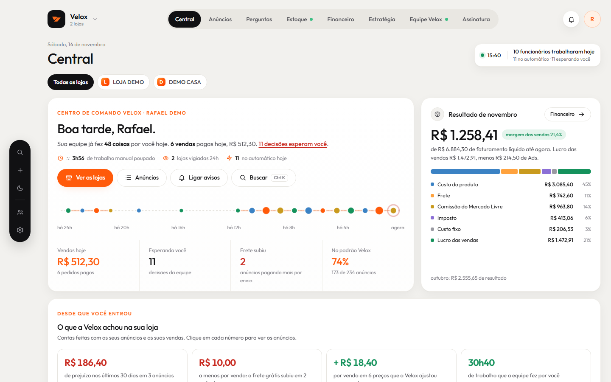

*The seller's command center: sales, margin, what the team found and the decisions waiting (demo data).*

- **AI agents write**: listings, technical specs, titles, answers to buyers, news articles and Instagram posts.
- **Code decides**: scores, prices, stock, daily caps, and what is allowed to go out.
- **The seller approves**: every skill is off, "ask for approval" or automatic, with a daily cap.

Jump to: [What Velox does on its own](#what-velox-does-on-its-own-24-hours-a-day) · [Mercado Livre integration](#mercado-livre-integration) · [The AI agents](#the-ai-agents) · [Results](#results) · [Velox is for sale](#velox-is-for-sale)

## What Velox does on its own, 24 hours a day

Velox was built as a product for many sellers, not as a tool for one store. The idea is to change how a small seller works: instead of spending the day creating listings, answering questions and fixing prices, the seller lets a team do it and only approves what matters.

### Automatic mode: the team works in the seller's account around the clock

Every skill on the team has 3 modes: **off**, **ask for approval** or **automatic**. In automatic mode, Velox works in the Mercado Livre account day and night, with no one clicking anything.

- **It only turns on with the seller's consent.** Automatic mode needs the terms accepted. Prices, titles and auto-answers each need one more acceptance of their own.
- **It has a daily cap.** The default is 30 automatic actions per store per day, and the seller picks from 1 to 500. Specs and titles have their own numbers.
- **Everything can be undone.** Every change keeps the previous value. Prices and technical specs have an Undo button.
- **Answers wait before they go out.** In automatic mode, only "confident" answers go out on their own, and they wait 3 minutes first so the seller can stop them.
- **It starts carefully.** During the free trial, Multiply, Recovery, Shipping and Questions stay in "ask for approval". If an ERP manages the store, Velox also forces approval where there could be a conflict.

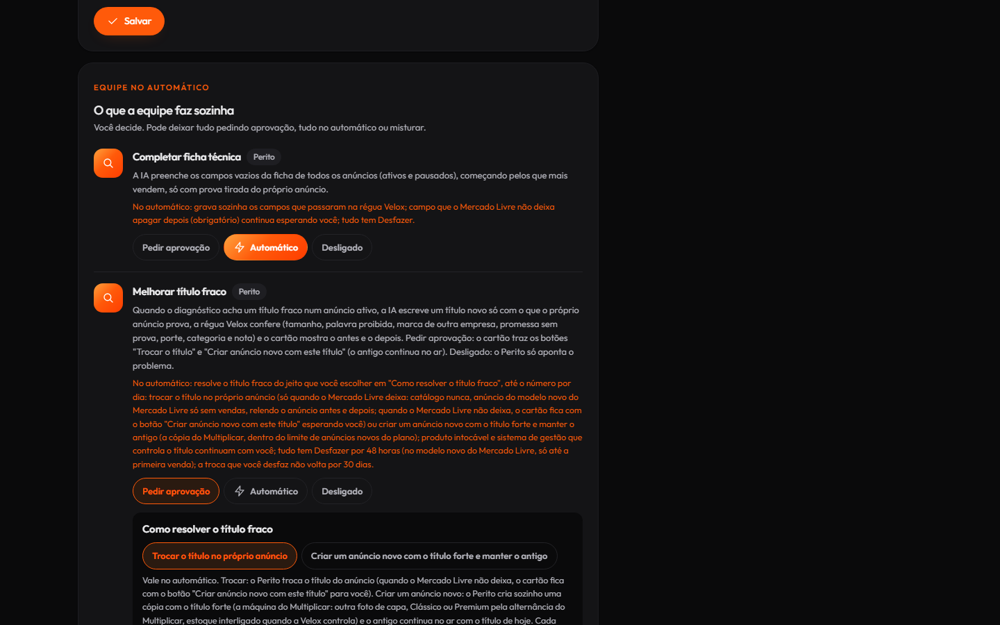

*Autonomy per skill: off, ask for approval or automatic, with daily caps and accepted terms (demo data).*

### Automatic listings: from a spreadsheet to a live listing

The Lister turns a spreadsheet into published listings.

1. **The seller sends the spreadsheet** with the products, and the photos as a zip, as links or in a Google Drive folder. The Drive folder is read every hour.
2. **AI writes the listing:** title, description and technical specs for each product. The category comes from code: the spreadsheet's category column, a similar listing in the store, or Mercado Livre's own category predictor.
3. **The price comes from the seller's margin,** with Mercado Livre's real fees.
4. **The cover photo is checked** with Mercado Livre's photo diagnostics API before the product enters the queue. If it fails, the product waits until the seller changes the cover or accepts it.
5. **Listings go out in the mode the seller chose:** one by one for approval, or straight to live, within the daily cap (default: 30 new AI listings a day).

The queue moves every 5 seconds, and the day's release runs every 30 minutes. The spreadsheet path is ready and tested, but as of Nov 14, 2026 no seller had used it in production yet.

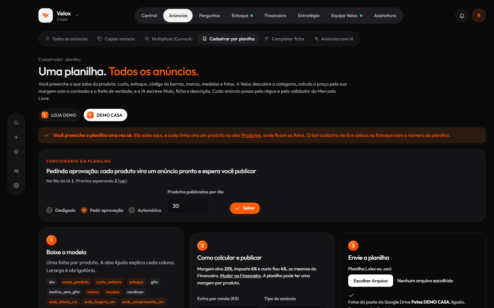

*Listing from a spreadsheet: products, photos and the publishing mode (demo data).*

### Curva A Multiplier: more reach for what already sells

"Curva A" is what Brazilian sellers call the few listings that bring most of the sales. Multiply puts those best sellers in front of more searches.

1. **It watches sales.** When a listing sells 2 units in 24 hours, or 5 in 7 days (the defaults), it becomes a candidate.
2. **It creates up to 2 new copies per round,** each with its own title for a different search, in the listing type the group has fewer of. So far, every round came out as one Classic and one Premium. The same product now reaches more buyers.
3. **No duplicate listings.** Velox never copies an active listing as-is, which Mercado Livre treats as an infraction. Each copy has its own title.
4. **One stock.** The original and its copies share the same stock, so nothing sells after it runs out.
5. **It waits 7 days** after the last copy, and only makes the next round if the sales trigger still holds, up to 4 copies by default.

As of Nov 14, 2026, Multiply had published **33 copies** in the connected stores.

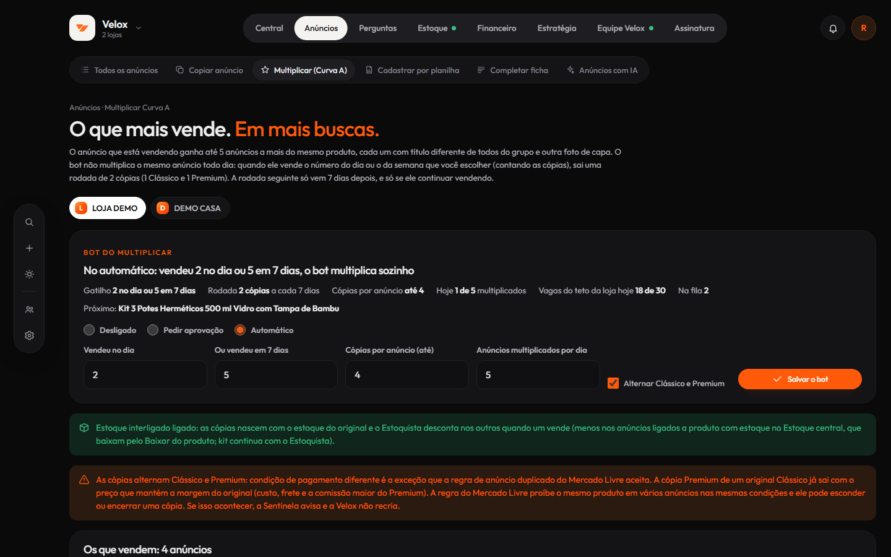

*Curva A Multiplier: the listings that sell and the copies made for other searches (demo data).*

### Inside Mercado Livre's rules

Velox was built to work inside the platform's rules, without pushing it.

- **Only the official API and the official login.** The seller connects the store on Mercado Livre's own screen, and Velox never sees the password. Tokens are stored encrypted.
- **Below the limit, with its own cap.** Mercado Livre allows 18,000 calls per hour for the whole app, which is 300 per minute. Velox's queue has its own cap of about 285 per minute, so it stays below the limit.
- **It brakes on its own.** If Mercado Livre asks it to slow down (a 429) or becomes unstable, the queue stops for 5 minutes. In the 7 days up to Nov 10, 2026, that happened once.
- **Fresh data.** Tokens are renewed every 30 minutes, and store data is never older than 6 hours, as the rules ask.
- **Nothing forbidden.** Velox never searches by seller and never creates duplicate listings.
- **Every change is controlled.** Either with the seller's approval, or in automatic mode with a daily cap, and always with the previous value kept.

The team also has the Customer Service agent answering questions, the Shipping Watcher protecting the margin, the Listing Expert improving specs and titles, the Recovery agent rebuilding listings that were taken down, and the Stock Keeper running the central stock. All of them are in [The AI agents](#the-ai-agents).

**Everything described here runs in production,** and the app's 2,329 automated tests pass (as of Nov 14, 2026).

## At a glance

| Number | What | Date |
|---|---|---|
| **26 + 30** | 26 AI agents and 30 rule robots working in 24-hour shifts ([catalog](docs/agents.md)) | as of Nov 14, 2026 |
| **7** | Mercado Livre stores connected | as of Nov 14, 2026 |
| **272** | listings monitored, in 3 stores | as of Nov 14, 2026 |
| **34** | listings published by the system (33 copies made by Multiply, 1 listing rebuilt by the Recovery agent) | as of Nov 14, 2026 |
| **1,555** | activity records from the store team (since Oct 2) | as of Nov 14, 2026 |
| **894** | AI calls logged by the app (since Oct 1); the 557 that went through the API cost US$ 14.02 in total | as of Nov 14, 2026 |
| **38** | news articles published by the AI newsroom (since Oct 14) | as of Nov 14, 2026 |
| **11** | Instagram posts published by the system (9 carousels and 2 Reels, Nov 3 to 9) | as of Nov 14, 2026 |
| **12** | n8n workflows | as of Nov 14, 2026 |
| **75,456** | lines of TypeScript in the main app (264 files), with 107 test files | as of Nov 14, 2026 |
| **135 / 91** | database tables / SQL migrations | as of Nov 14, 2026 |
| **0** | paying customers. Revenue from customers: R$ 0 | as of Nov 14, 2026 |

## The problem

Selling on Mercado Livre, Latin America's largest marketplace, takes a lot of repetitive work. Someone has to write listings that rank, fill in technical specs and answer buyer questions fast. They also have to react when shipping costs change, keep stock in sync across stores, and work out real profit after fees, ads and taxes.

Small sellers either do all of this by hand or pay an agency.

## What you get

Velox is sold as a working business, not only code. Each part below exists and has run in production.

| Part | What it is | Live since |
|---|---|---|
| **Seller app** | The product. A store team of 13 employees (5 use AI, 6 are rule robots, 2 are still in training), plus the command center, listings, buyer questions, central stock, finance and the rules notebook | Oct 1, 2026 |
| **Mercado Livre integration** | The official API: store connection (OAuth), listings, questions, orders, shipping, stock, catalog and real-time notifications | Oct 1, 2026 |
| **Admin command center** | Clients, AI cost per client, live activity, store agents across all clients, server and backups, team login with 2FA | Oct 13, 2026 |
| **Website with free trial and billing** | [veloxsolution.com.br](https://veloxsolution.com.br): a 7-day free trial and automatic billing by Pix or card through Asaas | Oct 21, 2026 |
| **AI newsroom** | Velox Notícias: research, writing, review by a second model, publishing and e-mail alerts | Oct 14, 2026 (first article) |
| **Instagram autopilot** | Carousels and Reels, published through the official Meta API | Nov 3, 2026 (first post) |
| **WhatsApp agent and n8n automations** | João, the sales and support agent, plus the trial journey, billing reminders and internal alerts | n8n on the server since Oct 28, 2026 |
| **Growth floor** | 10 AI agents for paid acquisition on Meta Ads. Only one rule robot is allowed to act on Meta | Nov 3, 2026 |
| **Velox AI HQ** | A pixel-art office that shows the real state of every agent | Inside the admin |
| **Brand and domain** | The Velox Solution name (not registered at INPI, the Brazilian trademark office), the veloxsolution.com.br domain (transferred to the buyer at Registro.br), the Instagram account and the Facebook page (the buyer becomes admin) | At handover |
| **Handover material** | A private code repository (about 1,800 files, with all 12 n8n workflows exported and no client data), a step-by-step installation guide, and in-app tutorial videos | Nov 14, 2026 |

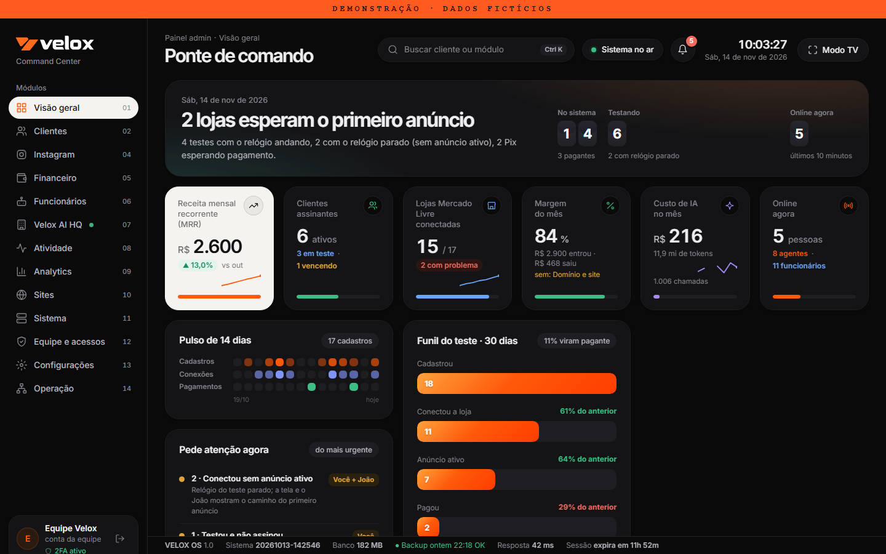

*Admin command center overview. Demo data: every client and every value on this screen is fictional, including the revenue.*
The admin also shows every store agent across all clients, the AI cost per client, server health and backups, live activity and the team's logins with 2FA. All admin screens are in [docs/screens.md](docs/screens.md#admin-command-center).

## Mercado Livre integration

This is the core of Velox. Everything goes through Mercado Livre's official API.


*The seller connects the store on Mercado Livre's own login screen. Velox never sees the password (demo data).*

### Connect the store

- **OAuth.** The seller logs in on Mercado Livre's official screen and authorizes the Velox app.
- **Encrypted tokens.** Tokens are stored encrypted with AES-256-GCM. The key exists only on the server.
- **Renewal.** A routine runs every 30 minutes. It renews any account whose token expires in less than 70 minutes, or that was not renewed in the last 3 days.
- **Watch.** The on-call robot raises an alert if a store's access has been expired for more than 15 minutes.

### Read the store

- **First read.** Right after connecting, Velox loads listings, quality, fees and sales. It takes a few minutes.
- **Read queue.** One read at a time, checked every 3 seconds. A store can have at most one pending or running read (a partial unique index in PostgreSQL guarantees it).
- **Data never older than 6 hours.** Mercado Livre's rules ask for data no older than 6 hours. A scheduler checks every 5 minutes and puts a store back in the queue 5 h 30 min after its last good read started. That gives about 4 reads per store per day.
- **Volume.** 536 reads since Oct 15 (the table keeps 30 days), as of Nov 14, 2026.

### Real-time notifications (webhooks)

- **Topics:** `items`, `items_prices`, `orders_v2` and `questions`.
- **Inbox first.** Each notification is stored before anything else, so a slow handler never loses an event. Up to 120 per minute per account and topic are accepted.
- **Processing.** Every 15 seconds, in batches of 50. On error, Velox retries after 2, 4, 8 and 16 minutes, and gives up on the 5th attempt.

### Listings

- **Velox score.** Every listing gets a score from 0 to 100 (title, specs, description, photos). The score is plain code, with no AI.
- **Technical specs.** The AI proposes only values it can prove from the listing, and shows the exact text that proves each one. It never invents a barcode or a brand. Mercado Livre's refusals are shown next to the result.
- **Titles.** Weak titles get a better version that follows the marketplace's title rules.
- **New listings from a spreadsheet.** Photos come as a zip, as links or from a Google Drive folder. The category comes from code (the spreadsheet column, a similar listing, or Mercado Livre's category predictor). The price comes from the target margin with real fees. The cover photo goes through Mercado Livre's photo diagnostics API before the product enters the queue.
- **Multiply best sellers.** When a listing sells 2 units in 24 hours or 5 in 7 days, Velox makes up to 2 copies per round, with titles that target other searches. The next round comes only 7 days later, and only if the sales trigger still holds.
- **Recovery.** When Mercado Livre takes a listing down, the Recovery agent builds a replacement with AI and market research. By default, the seller approves it before it goes live.
- **Official catalog.** The Copier can move a listing onto the official catalog page, through the official path.
- **No duplicate listings.** Velox never copies an active listing as a duplicate, which Mercado Livre treats as an infraction. Each copy gets its own title for a different search.

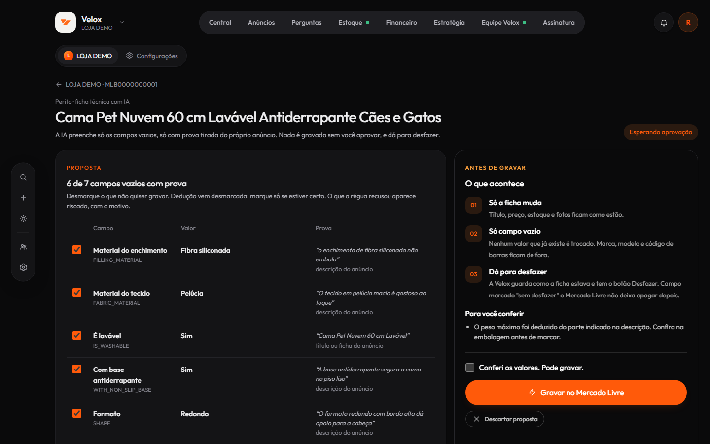

*AI-proposed technical specs: every value comes with the exact text that proves it (demo data).*

### Buyer questions

- A question notification triggers the Customer Service agent. It writes an answer from the listing, the store's notebook and past answers.
- A sweep runs every 3 minutes. A question that has waited more than 1 hour becomes a notice for the seller.
- In automatic mode, only answers marked "confident" go out. They wait 3 minutes first, so the seller can stop them. The rest go to the "Needs you" queue.

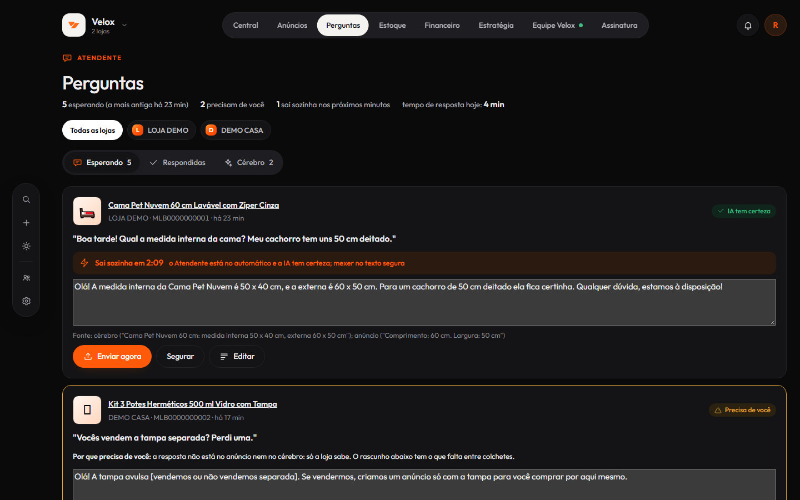

*Buyer questions: answers ready, a countdown before auto-send, and the ones that need the seller (demo data).*

### Orders and central stock

- **Live sales.** An order notification updates the central stock and the finance numbers.
- **Central stock.** One product, every listing in every store and every copy. Stock moves are stored in an append-only ledger with an idempotency key, so a double click counts once.
- **Backup sweeps.** Sales are re-checked every 3 minutes (up to 15 days back). Cancellations are checked every 30 minutes.
- **Volume.** 175 orders read and 190 stock writes to Mercado Livre since Oct 14, as of Nov 14, 2026.

### Shipping

- When the free-shipping cost of a listing goes up, the Shipping Watcher calculates the price that keeps the margin.
- In automatic mode it raises the price by at most 15% at a time (the default), and only if shipping went up by at least R$ 1 per sale. It never lowers a price.
- The on-call robot flags any listing whose price went up 3 or more times in 7 days.

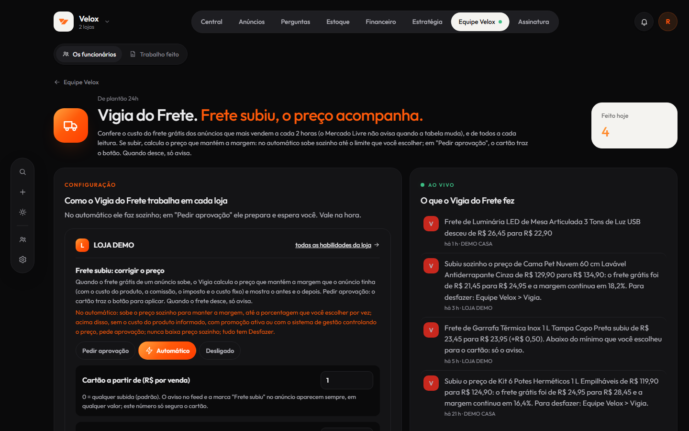

*Shipping Watcher: when free-shipping cost rises, it reprices to keep the margin, with Undo (demo data).*

### Rate limits and backoff

- Mercado Livre allows 18,000 calls per hour for the whole app. Velox's own queue never goes above about 285 calls per minute.
- On a 429, a 5xx, a network failure or a timeout, the read queue stops for 5 minutes.
- In the 7 days up to Nov 10, 2026, Mercado Livre asked Velox to slow down once.
- Velox never searches by seller, which the platform's terms forbid.

### Writes: approval first, automatic only with caps

- Writes to a listing happen only with the seller's approval, or in automatic mode with the terms accepted and a daily cap.
- Automatic mode needs the terms accepted. Prices, titles and auto-answers each need one more acceptance of their own.
- Default cap: 30 automatic actions per store per day. The seller can pick from 1 to 500. Specs and titles have their own daily numbers.
- During the free trial, Multiply, Recovery, Shipping and Questions stay in "ask for approval".
- If the seller says an ERP manages the store, Velox forces approval for Multiply, Recovery and Catalog.
- Every write keeps the previous value. Price and spec changes have an Undo button.

## The AI agents

As of Nov 14, 2026: **26 AI agents and 30 rule robots** working in 24-hour shifts. An AI agent calls a language model. A rule robot runs fixed rules, with no language model.

| Area | What the AI agents do | What the rule robots do | Who sees it |
|---|---|---|---|
| **Seller's stores** | Specs and titles, new listings, copies, rebuilt listings, answers to buyers | Watch listings, real margin, daily plan, shipping prices, daily report, stock, results measured 14 days later | The seller |
| **Newsroom** | Pick the story, write the article, judge it against the sources | Run the mission engine, read the sources, publish the approved version, measure, draw the art, notify search engines, send alerts | Internal |
| **Instagram** | Write carousels and Reels, review them in a council, learn from past Reels, weekly analysis | Publish, read metrics, read competitor posts | Internal |
| **WhatsApp and billing** | João (sales and support), Pix receipt reader | Trial journey, subscription reminders, trial clock, abandoned charges, Asaas reconciliation | Leads and clients talk to João |
| **Website** | Website assistant in the chat bubble | Site watcher | Visitors |
| **Growth (Meta Ads)** | 10 agents: direction, research, positioning, copy, scripts, QA, media buying, data, learning, activation | Funnel meter, treasury, campaign executor | Internal |
| **Operations** | | On-call robot with 8 watchers, stalled-WhatsApp watcher | Internal |

The seller sees 13 employees on the team screen. Only 5 of them use AI:

| Employee | Uses AI | Modes |
|---|---|---|
| Listing Expert | Yes (specs and titles; the score itself is plain code) | Specs and titles: off, approval or automatic |
| Recovery agent | Yes | Off, approval or automatic |
| Lister (spreadsheet and Multiply) | Yes | Off, approval or automatic |
| Copier | Yes (copies); the catalog step is plain code | Catalog: off, approval or automatic |
| Customer Service (with the store's Brain) | Yes | Off, approval or automatic |
| Sentinel | No | No mode: runs after every store read |
| Finance | No | Notify or off |
| Strategist | No | No mode: once a day per store |
| Shipping Watcher | No | Off, approval or automatic |
| Reporter | No | Notify or off |
| Stock Keeper | No | Central stock: automatic mode available |
| Radar | In training: not running yet | |
| Shipper | In training: not running yet | |

The full catalog, with triggers, modes, models and work to date: **[docs/agents.md](docs/agents.md)**.

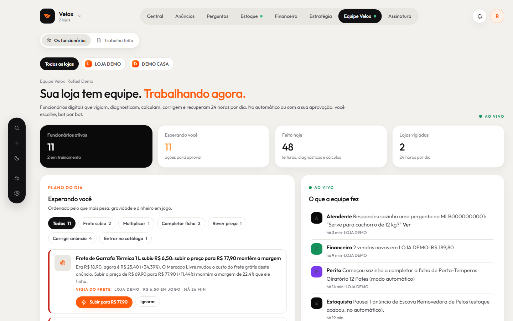

*The team screen: active employees, the approval queue and the live activity feed (demo data).*

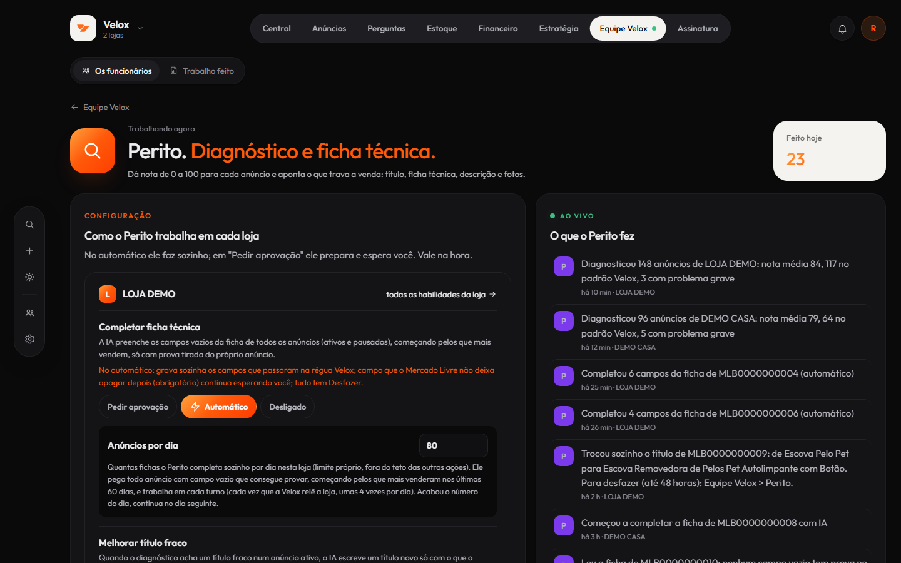

*Listing Expert: scores each listing 0 to 100, fills specs with proof and improves weak titles (demo data).*

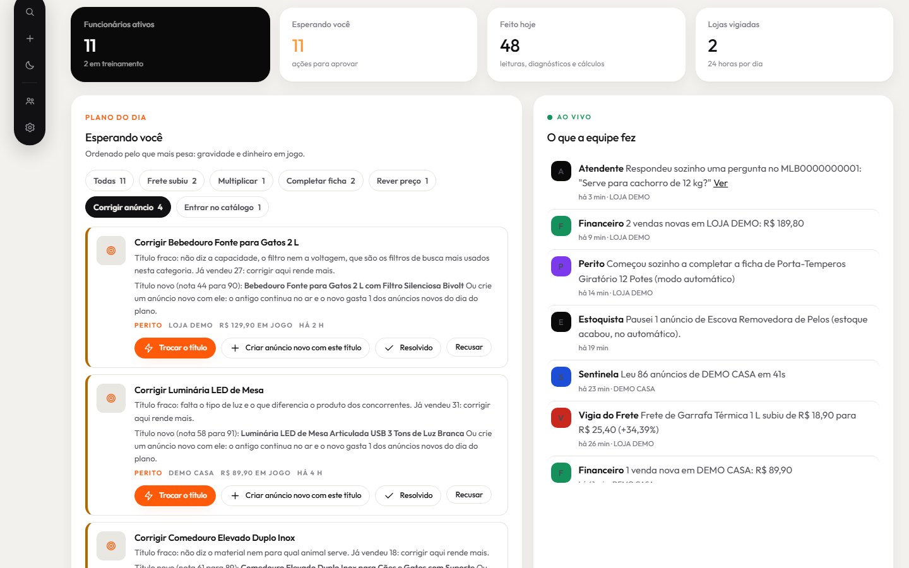

*Approval queue ("Needs you"): before and after for each change, with Approve, Resolved and Reject (demo data).*


*Autonomy per skill: off, ask for approval or automatic, with daily caps and accepted terms (demo data).*

### Finance and the rules notebook

- **Finance.** Gross sales match what Mercado Livre reports (it includes orders cancelled after payment). Net profit per sale and per listing comes after product cost, fees, shipping, ads, fixed expenses and interstate tax (Brazil's DIFAL).
- **Rules notebook.** Each store has a notebook: how the store works, what sells, and the rules every agent must follow. The Customer Service agent learns facts from the answers it sends, and the seller confirms what it learned.

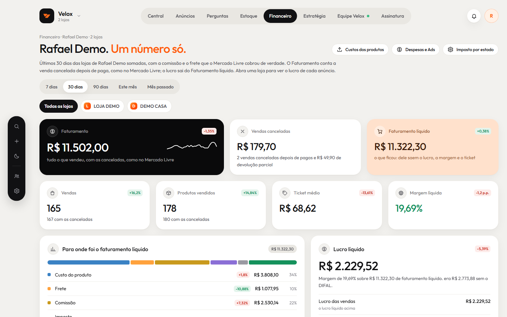

*Finance across all stores: gross the way Mercado Livre reports it, net, and where the money went (demo data).*

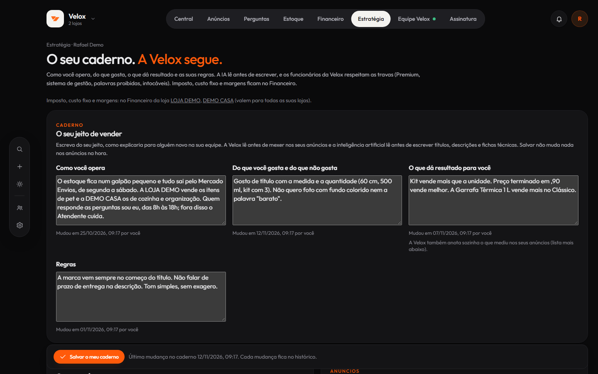

*The seller's notebook: how the store works, what sells and the rules every agent must follow (demo data).*

## The 24-hour team

Velox runs around the clock. A few examples:

- **Every 3 seconds:** the store read queue moves.
- **Every 15 seconds:** Mercado Livre notifications are processed, and confident answers that waited 3 minutes go out.
- **Every 3 minutes:** buyer questions and stock sales are swept.
- **Every 30 minutes:** tokens are renewed and shipping costs are checked.
- **Every day at 3:00:** encrypted backup of the app, n8n and the WhatsApp gateway.
- **Every day, 8:00 to 20:00:** the newsroom can publish up to 6 articles, 2 hours apart.
- **Weekdays at 8:00, 12:00 and 18:30:** Instagram posts, 15 a week.
- **All the time:** the on-call robot checks 8 failure signals every 10 minutes.

The full schedule, with what runs, when and who: **[docs/24-hours.md](docs/24-hours.md)**.

## Website, trial and billing


*The public website: "Your store can't depend on you for everything", with the 7-day free trial (demo data in the drawn panel).*

- **Website.** Static HTML, CSS and JavaScript, no framework. A sales page, a free Mercado Livre calculator, 6 pages (one per function, generated by a script), privacy policy, terms and a cookie notice. An AI assistant answers visitors in the chat bubble.
- **Measurement.** The Meta Pixel and the server-side Conversions API run only after the visitor accepts cookies, and the consent is recorded. Velox also counts its own visits with a daily hashed visitor ID and no IP address.
- **Free trial.** "Try 7 days" opens the sign-up inside the app. No card, one store. The 7 days only count while the store has an active listing. The trial has an AI budget of R$ 15 in total.
- **Billing.** Pix on the screen, or card in Asaas's secure window. No contract. Access is released automatically when the Pix clears. Cancel in one click; what was paid stays active until the end of the period.
- **Background checks.** Each Asaas event is processed once. Subscriptions are re-read from Asaas every 3 hours. An unpaid Pix is cancelled 5 days after its due date, and a card that fails for 7 days is cancelled too.
- **Pix receipts on WhatsApp.** The AI only transcribes the receipt. Code decides: Pix completed, plan amount, Velox as the receiver, date within 48 hours, and an ID in the Central Bank's format. It never creates access by itself.

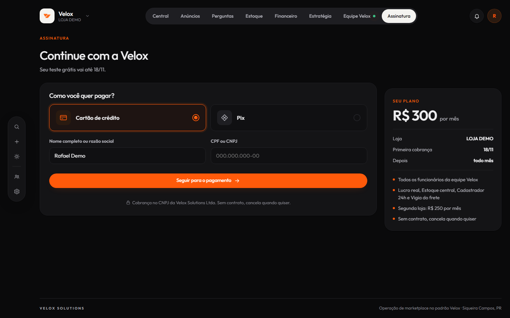

*Subscribe by card or Pix, no contract, cancel anytime (demo data).*

## Newsroom on autopilot

Velox Notícias (blog.veloxsolution.com.br) is a news site about marketplaces, written and published by AI agents.

1. **Sources.** A robot reads only registered and allowed feeds, with plain GET requests, and respects robots.txt. 28 public sources (news outlets and official bodies); 779 items collected as of Nov 14, 2026.
2. **Pitch.** The researcher (Claude Haiku 5.5) proposes 3 story ideas and picks one, saying why. Each idea needs 2 sources. Without 2 new items, the mission stops before calling the AI.
3. **Writing.** The SEO writer (Claude Haiku 5.5) writes an original article of 600 to 1,200 words and stores it as a versioned proposal with a hash.
4. **Anti-copy checks, in code.** No run of 10 words in a row equal to a source summary. No run of 6 words in a row equal to a source title. House writing rules. Honest limit: the check compares with the title and summary Velox collects, not with the full original article.
5. **Editorial judge on another model.** The editorial supervisor (Claude Sonnet 5.5) checks every claim against the sources. It approves, returns, rejects or asks for a human decision. If the judge and the writer were ever the same model, the approval turns into a human decision. At most 3 returns per article.
6. **Publishing.** The publisher ships only the exact approved version, checked by its hash. Between 8:00 and 20:00, at most 6 a day, 2 hours apart. Final approval is a setting: since Oct 29, 2026, the editorial supervisor approves and the article goes out on its own. The founder can switch back to human approval in the admin panel.
7. **After publishing.** Each article gets its own art (drawn in HTML and captured by a headless Chrome; nothing is taken from the internet), search engines are notified (IndexNow and sitemap), and e-mail alerts go to subscribers.
8. **Measurement.** Visits and clicks on the trial invite at 24 hours and 7 days, with no cookies and no stored IP.

**The process says no.** Of 93 missions, **49 were rejected by the process** itself, 6 failed, 28 are done and 10 are still being measured (as of Nov 14, 2026). The editorial supervisor gave 81 reviews: 43 approve, 21 return, 15 reject and 2 human decision.

**Transparency.** A "How we do it" page tells readers that each article is written by AI and checked by another AI against the sources. There is also a Corrections page.

Each pitch and each article has a dollar cap per day and per mission, and a brake in the admin panel stops new steps.


*Velox Notícias, the news site written and published by AI agents (public page).*

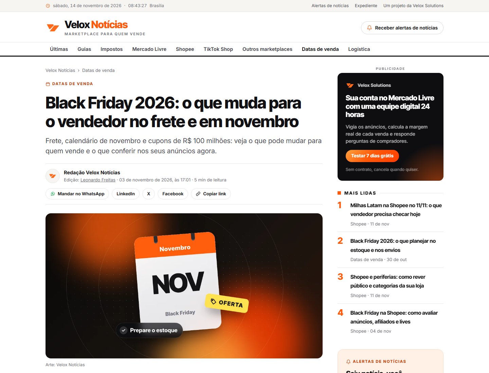

*An article from the AI newsroom, with sources checked by a second model (public page).*

## Instagram on autopilot

Velox's own Instagram account (@veloxsolution_) is run by AI agents. It makes carousels and Reels. It does not make stories.

- **Official API.** Posts go out through Meta's Instagram Content Publishing API (Graph API v24.0), with a system-user token from Velox's business portfolio. No password and no browser robot.
- **Writing.** The scriptwriter (Claude Opus 5.5) writes the slides, the caption, the hashtags, the alt text and the sources, or the Reel script.
- **Checks, then the sales council.** Code checks run first. Then the social supervisor takes the post to a council of 9 AI reviewer seats (psychology, buyer journey, adult learning, listening and rapport, SPIN, triggers, persuasion and objections, product, market and competition). The seats vote in one call: approve, adjust or reject, with vetoes. Code makes the final decision, not the AI.
- **Art.** A headless Chrome on the server draws the slides in three carousel formats.
- **No human approval.** A post that passes the checks and the council goes straight to the publishing queue.
- **Limits.** Up to 9 productions a day, at least 4 hours between posts, and a daily AI cap (US$ 5 in use). The grid in use: Monday to Friday at 8:00, 12:00 and 18:30.
- **Learning.** A hook hunter keeps a library of Reel hook types. A Reels director reads the last 3 weeks of Reels and writes the goal and up to 6 lessons for the next one.
- **Competitor radar.** An n8n workflow reads public posts of reference accounts through Meta's Business Discovery API (official; up to 60 accounts per run). 807 posts from 16 accounts read as of Nov 14, 2026.
- **Weekly analysis.** Every Monday at 7:00, an n8n workflow summarizes what worked. The scriptwriter reads it.

**Numbers (as of Nov 14, 2026):** 11 posts published from Nov 3 to Nov 9 (9 carousels and 2 Reels), 28 productions for US$ 7.49 of AI, 362 followers, and a summed reach of 674 with 1,192 views. No post went out from Nov 10 to Nov 15: a setting was saved with extra quotes, so the routine read "generation off" and stopped before any AI call. It was fixed on Nov 14 and the routine was switched back on on Nov 15. The next slot in the grid is Monday, Nov 16.


*Carousels and a Reel cover generated and published by the system through the official Meta API (real posts from Velox's own account).*

## WhatsApp and n8n automations

**João** is the sales and support agent on WhatsApp.

- He answers whoever writes, releases the free trial, receives Pix receipts and helps clients after reading their account in the app.
- His knowledge base is a set of Google Docs in a Drive folder. Changing a document changes João right away.
- Above 40 messages per number per day, n8n stops calling the AI for that number and alerts the founder.
- If a person asks to stop, automatic messages to them stop.
- Model: Claude Sonnet 5, through an n8n agent. His AI cost is not in the app's cost log.

**Trial journey.** Seven message types, each sent at most once per person, with text built by the app (no AI): a reminder to connect the store (1 hour, 1 day and 4 days after sign-up), a welcome with the store's numbers, a nudge after 2 days without logging in, a day-5 summary only when the team found something, and an end-of-trial message.

**Billing reminders.** 2 days before the due date and after it, at 10:00, 15:00 and 19:00. Text from the app, no AI.

**Internal alerts.** New sign-ups, connected stores, Pix events and system alerts go to the founder's WhatsApp every 30 minutes, from 7:00 to 22:30.

**n8n.** Self-hosted n8n on the same server, with 12 workflows (9 active). The main ones: the CRM (João), the trial journey, billing reminders, internal alerts, and Instagram publishing, metrics, competitor radar and weekly analysis. The other three are switched off.

**The gateway.** WhatsApp runs on a WhatsApp Web gateway on the server, restarted by systemd if it stops. Migration to the official WhatsApp Cloud API is available.

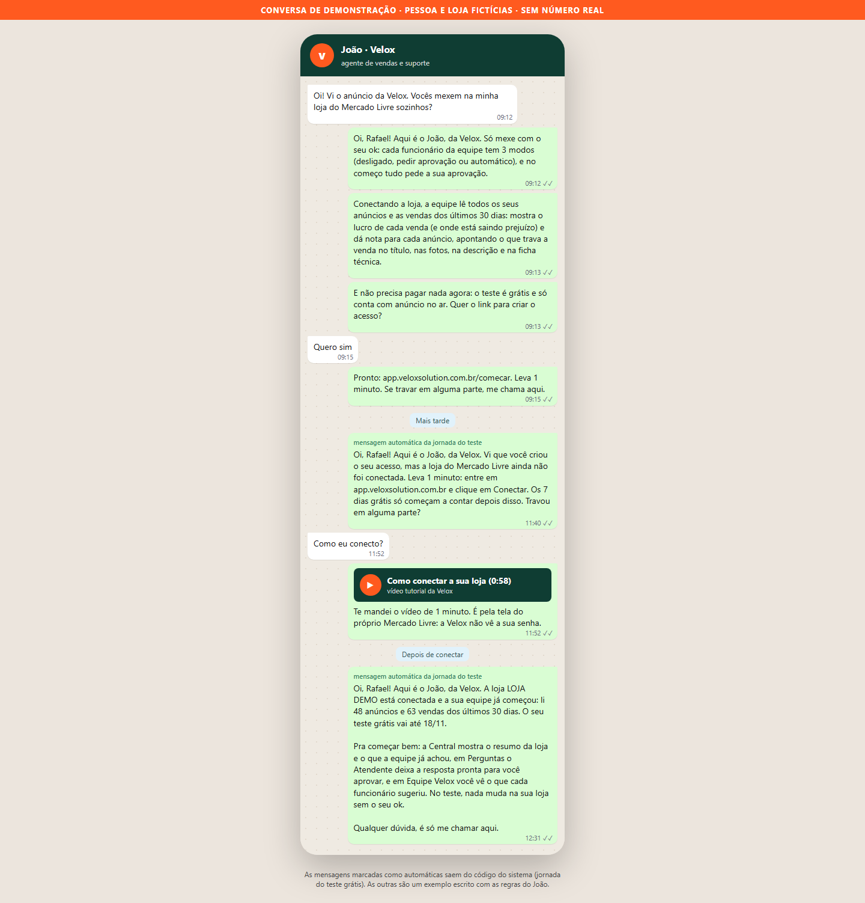

*Demo WhatsApp chat with João. Person and store are fictional; the messages marked as automatic come from the real code.*

## How the APIs are used

| API | What Velox does with it |
|---|---|
| **Mercado Livre** | OAuth connection; reads listings, orders, questions and fees; webhooks (`items`, `items_prices`, `orders_v2`, `questions`); writes specs, titles, prices and stock; publishes new listings and copies; answers buyer questions; joins the official catalog |
| **Anthropic Claude** | 18 task routes across Claude Haiku 5.5, Sonnet 5.5 and Opus 5.5, each call logged with tokens and cost. João (n8n) uses Claude Sonnet 5, and the weekly Instagram analysis calls the API from n8n |
| **Asaas** | Subscriptions by Pix and card, payment webhooks (each event processed once), reconciliation every 3 hours, cancelling abandoned charges |
| **Meta Graph API: Content Publishing** | Publishes Instagram carousels and Reels |
| **Meta Graph API: Business Discovery and metrics** | Reads public posts of reference accounts (competitor radar, up to 60 accounts per run) and the reach, saves, shares and followers of Velox's own posts |
| **Meta Conversions API** | Sends site and funnel events from the server every 5 minutes |
| **Meta Marketing API** | Used by the growth floor's campaign executor: pause, resume, adjust budget and create ad, only with a proposal from the paid media agent and a creative approved by QA |
| **Google Drive** | João's knowledge base (Google Docs) and product photo folders for bulk listing (read every hour) |
| **Resend** | Transactional e-mail: newsroom alerts and password reset |
| **WhatsApp gateway** | Receives and sends WhatsApp messages through a WhatsApp Web gateway, connected to n8n by webhook. Migration to the official WhatsApp Cloud API is available |
| **IndexNow** | Tells search engines about each new article |

## The Velox building (Velox AI HQ)

Picture the whole company inside one building. That is **Velox AI HQ**: a pixel-art office called **Velox Tower**, where each agent appears as an employee in the room of its area, doing what it is doing right now.

It shows the operation live: who is working, who needs a human decision, who hit an error and who is idle.

**[▶ Watch the 32-second tour of the building](prints/94-hq-demonstracao.mp4)** (demo mode, simulated data).


*Velox Tower from the outside: each floor is an area of the company, and the windows light up with the people really working (demo mode, simulated data).*

### How it works

- **The HQ shows; the agents do the work.** The work happens in the server routines, in n8n and in the AI agents. The HQ reads the real state of each one and draws it. In the admin panel, a pending decision can be made right on the employee's badge.
- **Golden rule: nothing made up.** Anything the code cannot confirm shows as **"unknown state"**. Decoration never blinks without real data.
- **Animation follows reality.** A character only walks when its real state changes. The elevator only moves when someone really changes floors. Window lights come from the real count on each floor, and a floor with someone who needs you blinks orange.
- **Where the data comes from:**
  - the store employees;
  - João (shown as "working" if his last signal is less than 2 minutes old);
  - the real step of each newsroom mission;
  - the sales council and the on-call robot;
  - the follow-up, support, reminders, WhatsApp, backup and n8n routines;
  - the growth floor and the Instagram studio;
  - the Claude Code sessions that build Velox itself. The HQ reads only their state, never the content of the conversations.

### The floors

| Floor | Area | Rooms |
|---|---|---|
| Ground | Reception and clients | Monitoring center, Clients, Customer support and the Reception |
| 1 | On-call and infrastructure | Security, Infrastructure, System on-call |
| 2 | Velox Notícias newsroom | Newsroom |
| 3 | Sales | Sales and CRM, Strategy and funnel, Sales council |
| 4 | Marketing and content | Instagram studio, Website and SEO, Reels and video studio, Community |
| 5 | Client stores | Marketplace and automations, Clients' Mercado Ads |
| 6 | Engineering | Development, Design and UI/UX, Quality and testing |
| 7 | Finance and governance | Intelligence, Velox finance, Governance |
| 8 | Meta Ads and growth | Traffic command, Intelligence and brand, Ad creation, Paid media and QA, Data and learning, Funnel and revenue |
| Top floor | Board | Board room and meetings |

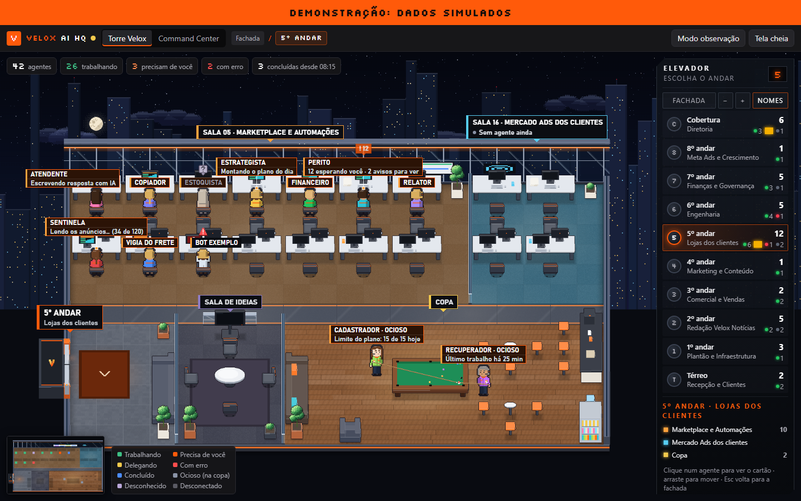

*Floor 5, where the store employees work: each desk shows its current task (demo mode, simulated data).*

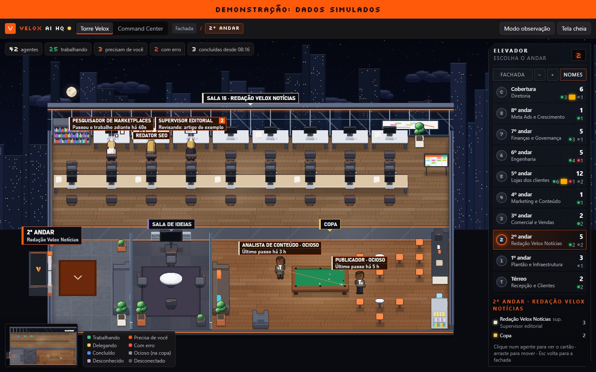

*Floor 2, the newsroom: the researcher, the writer and the editorial supervisor (demo mode, simulated data).*

### What the screen shows

- **Number strip:** agents, how many are working, how many need you, how many hit an error, and tasks done today.
- **Facade and elevator:** the tower at night, with one button per floor showing how many are there.
- **A floor from above:** rooms with name plates, the elevator hall and the break room, with a minimap, zoom and drag.
- **Characters:** clothes show the role. Robots wear their area's color, Claude Code sessions wear navy and coral, and supervisors wear a graphite suit with an orange scarf. Idle agents go to the break room. A disconnected one becomes an empty chair.
- **Speech bubbles:**
  - "!" when it needs you;
  - a check mark for 6 seconds when it finishes;
  - a red alert on error;
  - "?" when the state is unknown;
  - an arrow when it delegates, linking who passed the task to who got it, even across floors.
- **Agent badge:** mission, source, supervisor, last delivery, cost, result and blocker, plus active tools, counters and its timeline.
- **Command Center tab:** 11 number cards and 4 columns: Needs you, Working, Idle, and Unknown or Disconnected.
- **Watch mode:** hides the panels and moves the camera every 9 seconds through the rooms where someone is working. It looks good on a TV on the wall.

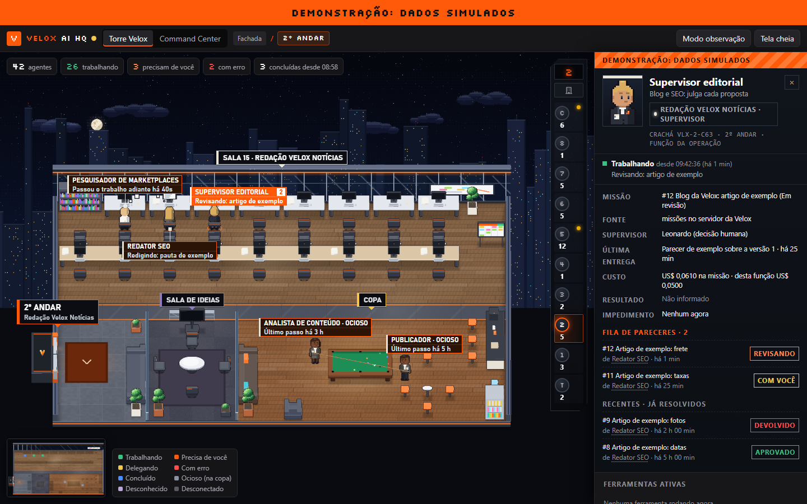

*Agent badge: mission, supervisor, cost, last delivery and the work queue (demo mode, simulated data).*

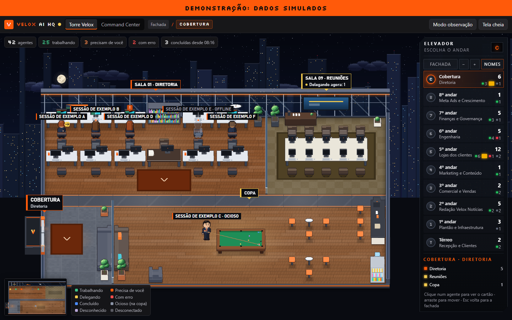

*Top floor: the board, where Claude Code sessions appear and delegate work (demo mode, simulated data).*

### Who sees it and where it runs

- **Only the Velox team, inside the admin panel.** Clients do not see the HQ.
- **Two versions, one screen:**
  - the desktop HQ, which gets changes live over WebSocket;
  - the online HQ inside the admin panel, which refreshes every second.
- **Demo mode:** 42 fictional agents, no network at all, and the "simulated data" banner always on. That is what the screenshots and the video show.

### Tech

React 18, TypeScript and Vite, with a custom Canvas 2D renderer (no game engine). It draws up to 60 frames per second while something moves, and drops to about 10 when nothing does, to stay light. 32,583 lines of code with 59 test files. The characters are original art.

## AI engineering

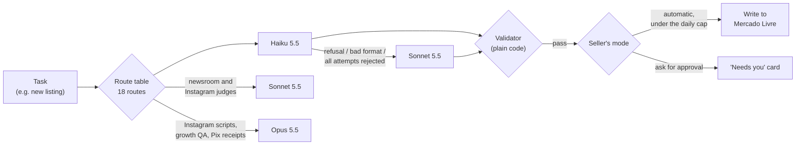

- **A route per task.** 18 routes across Claude Haiku 5.5, Sonnet 5.5 and Opus 5.5. Haiku 5.5 does the volume and escalates once to Sonnet 5.5 if it refuses, returns a broken answer, or the validator rejects all its attempts. The newsroom and Instagram judges run on Sonnet 5.5. Opus 5.5 handles the Instagram writing, the growth QA and Pix receipts.
- **No escalation without confidence.** When the Customer Service agent is not sure, it does not try a bigger model. The question goes to the seller.
- **Validators before anything reaches a customer.** Plain-code checks run on every AI output: forbidden words, misleading claims, size and category consistency, and marketplace title rules.
- **The author never judges its own work.** The editorial judge runs on a different model from the writer. The growth QA never reviews its own material.
- **Configs chosen with tests on real data.** The Customer Service agent runs on Haiku 5.5 with high effort and only escalates to Sonnet 5.5 on errors. Measured in production, a Haiku answer costs about 1/15 of an Opus one (small sample).
- **About 13× cheaper listings.** Measured in production before Oct 27, 2026: generating a listing went from about US$ 0.12 on Opus to about US$ 0.009 on Haiku, with validators and evals keeping the quality.
- **Every call is logged.** Tokens (including cache) and cost, converted to reais with the Central Bank's PTAX rate for that day.
- **Budgets.** Default plan limits per client, the values in use as of Nov 14, 2026: 30 new AI listings, 30 spec sets and 10 titles per day, 50 answers per store per day, and R$ 120 of AI per month. The free trial has R$ 15 of AI in total. The newsroom engine checks a brake and a dollar cap before every step. Instagram has a daily dollar cap. The website assistant has a cap of US$ 3 per day.
- **Kill switch.** One environment variable can force every route to a single model.

**AI cost to date (as of Nov 14, 2026):** 894 calls logged since Oct 1, 833 of them successful. 557 went through the Anthropic API and cost **US$ 14.02** in total (Opus US$ 8.46, Sonnet US$ 4.54, Haiku US$ 1.03). The biggest spend was Instagram through the API on Nov 3 to 5: US$ 7.60. AI linked to client stores cost US$ 1.40 for listings, US$ 0.10 for answers and US$ 0.01 for specs. João's AI cost runs through n8n and is not in this total.

## Architecture

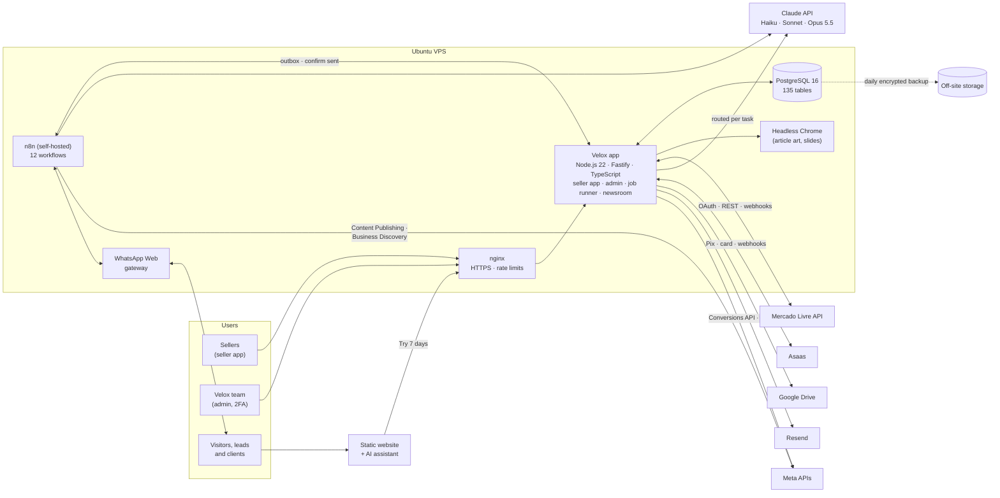

- **One Node.js process** (Fastify) serves the seller app as server-rendered HTML, plus the admin API. The admin command center is a React and Vite single-page app served by the same app.
- **Background work** (store reads, agents, token renewal, webhooks, newsroom missions) runs in the same process on a PostgreSQL-backed job queue. At this scale that means no Redis and fewer moving parts. Routines never overlap: if the previous run is still going, the next one is skipped.
- **n8n** owns the messaging and Instagram publishing workflows and talks to the app through a few small, authenticated endpoints.
- **Each seller has their own login** and sees only their own stores. One installation serves one business.

## Database

PostgreSQL 16 with **135 tables** (104 in the main schema, 11 for Instagram, 10 for site measurement and 10 for the growth floor), built through **91 plain-SQL migrations**, as of Nov 14, 2026. Table names are in Portuguese because the product is Brazilian.

| Domain | Main tables | What they hold |
|---|---|---|
| Clients and access | `clientes`, `usuarios`, `sessoes`, `contas_ml`, `oauth_estados` | Clients, logins, connected Mercado Livre stores |
| Listings | `anuncios`, `anuncio_grupos`, `rascunhos`, `fichas`, `catalogo` | Listings read from the marketplace, original and copy groups, AI drafts, technical specs |
| Products and stock | `produtos`, `vinculos`, `movimentos` | Central products, listing-to-product links, the append-only stock ledger |
| Sales and finance | `pedidos`, `custos`, `despesas_fixas`, `ads_dia`, `difal_aliquotas`, `frete_historico` | Orders, unit costs, expenses, ad spend, interstate tax rates, shipping history |
| AI and agents | `ia_chamadas`, `acoes`, `atividade`, `perguntas`, `cerebro`, `estrategias`, `intocaveis`, `aprendizados` | Every AI call with tokens and cost, proposals waiting for approval, the activity log, buyer questions, each store's notebook and rules, measured outcomes |
| Integrations and jobs | `sincronizacoes`, `notificacoes_ml`, `avisos_internos`, `jornada_mensagens`, `lembretes_assinatura` | Read queue, webhook inbox, outbox rows consumed by n8n |
| Billing | `asaas_cobrancas`, `asaas_eventos`, `comprovantes_pix` | Subscriptions and payment events |
| Admin and operations | `painel_contas`, `painel_sessoes`, `painel_registro`, `missoes`, `propostas`, `execucoes` | Admin accounts with 2FA, the audit log, agent missions with versioned proposals |
| Instagram | 11 tables in their own schema | The Instagram engine, including the weekly analysis the scriptwriter reads |
| Site measurement | 10 tables | Visits with a daily hashed visitor ID, no IP |
| Growth floor | 10 tables | The growth agents' work |


Patterns used:

- **Versioned migrations.** 91 plain-SQL migrations, applied in order by a small CLI, so every schema change is reviewable and reproducible.
- **Job queue with deduplication.** A partial unique index guarantees at most one pending or running read per store:
  ```sql
  insert into sincronizacoes (conta_id, pedida_por) values ($1, $2)
  on conflict (conta_id) where status in ('pendente', 'rodando') do nothing
  ```
- **Append-only stock ledger.** `movimentos` only gets new rows. Each row has a unique idempotency key, so a double click or a duplicated tab counts once.
- **Webhook inbox.** Mercado Livre notifications are stored first and processed later, so a slow handler never loses an event.
- **Outbox with acknowledgement.** The app writes the messages that need to go out, with a unique key so the same alert is never queued twice. n8n reads the outbox, sends each message and confirms back. A message counts as sent only after that confirmation.
- **Tamper-proof audit trail.** Agent missions store each proposal version with a SHA-256 hash, and the publisher can only execute the exact approved hash. Database triggers block `UPDATE`, `DELETE` and `TRUNCATE` on the execution log.

## Infrastructure and reliability

- **Hosting.** An Ubuntu 24.04 VPS with nginx as the reverse proxy (HTTPS, rate limits). The app, n8n and the WhatsApp gateway run as systemd services and restart on their own (in 3, 5 and 10 seconds). The website is static and hosted separately.
- **One-command deploy.** It runs the tests and stops if any of the 107 test files fails. Then it builds, uploads a new release folder, switches the "current" symlink atomically and restarts the service. If the health check (`/saude`) fails, it **rolls back on its own** to the previous release, within about 30 to 90 seconds. The server keeps the last 5 releases.
- **Daily encrypted backups.** Every day at 3:00: the app database, n8n and the WhatsApp gateway, in 3 encrypted files. Backups are encrypted with `age`, and only the public key lives on the server, so even someone who breaks into the server can't read them. 8 copies stay on the server, and 31 days of copies in a separate hosting account at the same provider.
- **On-call robot.** Every 10 minutes, 8 read-only SQL watchers look for failures that cost money or clients: a store read that failed in the last 24 hours, an answer that failed to send, 3 or more AI errors in 6 hours, the same listing repriced 3 or more times in 7 days, a charge overdue for more than 5 days, Mercado Livre access expired for more than 15 minutes, a store in good standing with no read for 12 hours, and an AI request left without an answer for 30 minutes. A new serious alert goes to the founder's WhatsApp. The robot never fixes anything by itself.
- **Site watcher.** Every 15 minutes it checks 6 rules (among them: site down, the trial button, stalled e-mail and articles below target), with at most 3 alerts a day.
- **Admin access.** Password plus TOTP 2FA, 12-hour sessions, and every action in an audit log.
- **Safe data migrations.** Risky changes are rehearsed first, on a copy of the database or inside a transaction that is rolled back.
- **Server.** 13 GB used of 96 GB as of Nov 14, 2026. Backups of Nov 12, 13 and 14 checked in the folder.

**Known limits, stated plainly:**

- WhatsApp runs on a WhatsApp Web gateway, not the official API. It was down from Oct 13 to 26 and from Nov 6 to 9 without an alert. Migration to the official WhatsApp Cloud API is available.
- The newsroom, Instagram and growth floor can run their AI on a desktop Claude worker (as today) or through the API on the server. On Nov 14, 2026, one full round of all three through the API, on a copy of the database, cost US$ 0.87. The switch is one setting and is made at handover, so the buyer needs no desktop machine.
- One installation serves one business. There is no multi-company layer.\n- No alert reaches a phone yet when the WhatsApp gateway goes down; today the outage shows on the HQ and the admin panel. The WhatsApp gateway backup also failed on 6 of the last 10 days. Both fixes are on the handover list.

## How I built it

Built with AI agents (Claude Code) under my direction. I own the product, the architecture decisions, QA and production operations. AI coding agents write most of the code; I direct, review and test it.

The work moves in **waves**:

1. Agree on the scope.
2. Approve a clickable prototype.
3. Ship in small pieces.
4. Test on a real store.
5. Fix what breaks, then start the next wave.

Big releases go through independent reviews before shipping. 107 test files with 2,329 tests guard the main app (all passing as of Nov 14, 2026), and a deploy is blocked if any of them fails.

| Part | Size (as of Nov 14, 2026) |
|---|---|
| Main app | 75,456 lines of TypeScript in 264 files; 107 test files (35,389 lines) |
| Admin command center | 18,557 lines; 14 test files |
| Velox AI HQ | 32,583 lines; 59 test files |
| Website | 5,853 lines of HTML, CSS and JS in 69 files, plus a 1,250-line page generator |
| Server scripts | 2,559 lines |
| Total | about 177,000 lines, with tests, comments and blank lines |

## Timeline

| Date (2026) | Milestone |
|---|---|
| Aug | Velox starts as a store-management service for Mercado Livre sellers |
| Sep 1 | WhatsApp agent's knowledge base and CRM tables created |
| Sep 30 | Server provisioned; platform build starts |
| Oct 1 | Platform live; first listing published by the system |
| Oct 6 | First real store connected (a pilot store, run by the Velox team) |
| Oct 13 | Velox becomes software-only (SaaS); admin command center live |
| Oct 14 | First article from the AI newsroom |
| Oct 21 | New website with a self-serve 7-day trial and automatic billing |
| Oct 23 | First sign-ups from outside users through the website |
| Oct 28 | Self-hosted n8n moves to the server |
| Nov 1 | WhatsApp gateway moves to the server |
| Nov 3 | First Instagram post from the autopilot; growth floor starts |
| Nov 9 | Meta Ads paused by the founder; last Instagram post before a pause caused by a settings bug (fixed Nov 14, routine back on Nov 15) |

## Results

Honest numbers, as of Nov 14, 2026. They come from the launch and test phase, since the system went live on Oct 1, 2026, with the pilot store and free-trial accounts. They show the system working for real, in real Mercado Livre stores.

**Business**

- **No paying customers yet. Revenue from customers: R$ 0.** The only Pix Velox received was the founder's own R$ 5.00 test on Oct 21.
- 11 sign-ups: 1 pilot store (connected Oct 6 and run by the Velox team, not a paying client) and 10 through the website from Oct 21 to Nov 6 (one of them the founder's own test).
- Of the 10 website sign-ups, 6 connected a store, and only 2 of those stores have listings. 4 trials are open, all with the trial clock paused because they have no active listing. 1 trial ended without paying. 3 accounts were cancelled.
- **7 Mercado Livre stores connected** (the pilot and 6 from website sign-ups).

**Work done by the agents**

- 272 listings monitored (232 active, 39 paused, 1 under review) in 3 stores.
- 34 listings published by the system: 33 copies made by Multiply and 1 listing rebuilt by the Recovery agent. None yet from a spreadsheet.
- 1,555 activity records from the store team since Oct 2. The biggest: Listing Expert 366, Finance 358, Sentinel 315, Reporter 147.
- 99 actions proposed for approval: 13 done, 29 resolved, 57 still pending.
- 190 stock writes to Mercado Livre since Oct 14; 175 orders read; 147 daily reports.
- 29 buyer questions read: 3 answered by Velox, 24 answered by the seller directly on Mercado Livre, 2 without an answer.

**Content and traffic**

- Newsroom: 38 articles (Oct 14 to Nov 14, 760 words on average). 52 visits by its own count from Oct 14 to Nov 12, and 0 clicks on the trial invite. 1 e-mail subscriber.
- Website: 286 visitors and 11 clicks on "try" from Nov 1 to 13.
- Instagram: 11 posts, 362 followers.
- Meta Ads, Nov 3 to 9: R$ 76.22 spent, 12,030 impressions and 305 link clicks. Paused since Nov 9. The growth floor ran 84 rounds from Nov 3 to Nov 14, and Meta confirmed 12 actions that came through the agent flow (6 ads created, 6 paused).

**From the first weeks (October 2026)**

- The pilot store's monthly revenue in Velox matched Mercado Livre's official report to the cent.
- On its first read of the pilot store, Velox found an ad campaign that had been running for over a month without the owner knowing.

## Lessons learned

- **Building is not selling.** The newsroom published 38 articles in a month and got 52 visits. Velox has 0 paying customers. Distribution needs its own plan, from day one.
- **A small model with good validators and real evals beats "always use the biggest model".** Listings got about 13× cheaper with the same decisions.
- **Not everything needs AI.** 6 of the 11 working store employees are plain rules, with no language model. AI writes and finds proof; code does the math and enforces the limits.
- **Let users choose autonomy.** Off, approval or automatic per skill lets a seller start with approvals and hand over only what they trust.
- **Reconcile against the source of truth.** Matching the marketplace's own numbers showed that its gross sales include orders cancelled after payment. Without that check, it would have looked like a bug in front of a client.
- **Test the alert, not only the thing it watches.** The WhatsApp gateway went down twice without an alert reaching a phone. A watcher is only useful if its own alert path works.
- **No single machine should hold the business.** When one desktop worker stopped for a day, the newsroom, Instagram and the growth floor stopped with it.

## Velox is for sale

Velox is for sale as a whole: the product, the brand and the machine around it.

**What's included**

- The seller app and its Mercado Livre integration, with the full source code in a private repository.
- The admin command center and Velox AI HQ.
- The website with the free trial and automatic billing (Asaas).
- The AI newsroom (Velox Notícias) and the Instagram autopilot.
- João on WhatsApp and the n8n automations.
- The growth floor for Meta Ads.
- The brand and the domain: the Velox Solution name (not registered at INPI, the Brazilian trademark office), the veloxsolution.com.br domain, transferred at Registro.br, and the Instagram account and the Facebook page, with the buyer as admin.
- A step-by-step installation guide, including how to create a new backup key and test a restore.

**Handover**

I install everything on your server and accounts and leave it running and tested, in about 5 business days.

- You create your own accounts: server, Mercado Livre developer app, Meta business portfolio, Asaas, Anthropic, Google, Resend and a WhatsApp number.
- I install the server, restore the database, set up the app with your keys, import the n8n workflows, pair WhatsApp, set up Meta and Instagram, the website, DNS and e-mail, and run an end-to-end test.
- Each connected store authorizes again, because Mercado Livre tokens belong to the developer app.
- The work itself is about 21 to 33 hours (my estimate). It spreads over about 5 business days because of the waits: Meta approval, DNS, WhatsApp pairing and each store authorizing again.

**Training and support included:** 4 hours of training in two video calls (one on the admin panel and the HQ, one on the seller app and the automations) and 30 days of bug fixes and questions over WhatsApp after handover. New features are a separate service.

**Optional services after handover**

- **Monthly maintenance:** monitoring, backups and security updates, bug fixes, changes when Mercado Livre, Meta or another platform changes its rules or API, and AI cost follow-up.
- **New features,** by project or by a pack of hours. For example:
  - a mobile app (Android and iPhone);
  - other marketplaces: Shopee, Amazon, TikTok Shop and Magalu;
  - ERP integrations (Bling, Tiny);
  - new agents, or new skills for the current ones;
  - new reports;
  - migration to the official WhatsApp Cloud API (already planned: about 11 to 17 days);
  - Instagram stories (already planned: about 2 and a half weeks);
  - changes to the website, the newsroom or Instagram.

**For the buyer of Velox, these expansions come at a special price.**

The same 24-hour AI team model, with human approval, can be adapted to other businesses. See [docs/other-businesses.md](docs/other-businesses.md).

**Price on request.**

- Website: https://veloxsolution.com.br
- Book a call: https://cal.com/leofreitas-dev/intro
- WhatsApp: [+55 43 9694-9485](https://wa.me/554396949485)
- Email: leonardofreitasdev06@gmail.com

## More

- [docs/agents.md](docs/agents.md): every AI agent and rule robot
- [docs/24-hours.md](docs/24-hours.md): the 24-hour routine
- [docs/screens.md](docs/screens.md): every screen, in journey order
- [docs/other-businesses.md](docs/other-businesses.md): what can be reused in another business

## About

Built by **Leonardo Freitas**, AI automation engineer in Brazil (UTC-3). I build AI automations that don't break: quote desks, lead intake, n8n workflows, self-hosted or cloud.

If you want to buy Velox, or want a 24-hour AI team with human approval for your own business, get in touch.

- Book a 20-min intro call: https://cal.com/leofreitas-dev/intro
- WhatsApp: [+55 43 9694-9485](https://wa.me/554396949485)
- Email: leonardofreitasdev06@gmail.com
- GitHub: https://github.com/leofreitas-dev

Built with AI agents (Claude Code) under my direction.

---

All screenshots of the apps use demo data. The newsroom and Instagram images show Velox's own public pages and posts. The source code is private and is delivered to the buyer.
