🇺🇸 [Read in English](README.md)

# Velox: uma equipe de IA que toca lojas do Mercado Livre 24 horas por dia

A Velox é um SaaS brasileiro em que agentes de IA e robôs de regra fazem o trabalho diário de uma loja do Mercado Livre (anúncios, perguntas dos compradores, preços, estoque e lucro), e o vendedor aprova o que importa.

Este repositório é um estudo de caso. Ele não tem código-fonte. **A Velox está à venda por inteiro**: o produto, o site, o jornal, o motor do Instagram, as automações e a marca. Veja [A Velox está à venda](#a-velox-está-à-venda).

https://github.com/user-attachments/assets/196f4c64-e14e-4cb2-bc5e-66784c5c7fe4

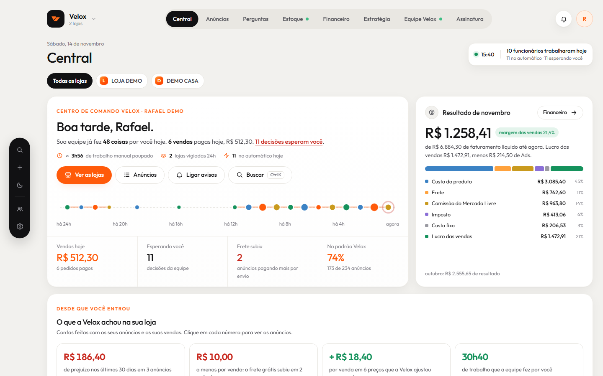

*A Central do vendedor: vendas, margem, o que a equipe encontrou e as decisões que estão esperando (dados de demonstração).*

- **Os agentes de IA escrevem**: anúncios, fichas técnicas, títulos, respostas pros compradores, matérias do jornal e posts do Instagram.
- **O código decide**: notas, preços, estoque, limites diários e o que pode sair.
- **O vendedor aprova**: cada habilidade fica desligada, em "pedir aprovação" ou no automático, com limite diário.

Ir para: [O que a Velox faz sozinha](#o-que-a-velox-faz-sozinha-24-horas-por-dia) · [Integração com o Mercado Livre](#integração-com-o-mercado-livre) · [Os agentes de IA](#os-agentes-de-ia) · [Resultados](#resultados) · [A Velox está à venda](#a-velox-está-à-venda)

## O que a Velox faz sozinha, 24 horas por dia

A Velox foi criada pra ser um produto pra muitos lojistas, não uma ferramenta de uso próprio. A ideia é mudar o jeito como o pequeno lojista trabalha: em vez de passar o dia cadastrando anúncio, respondendo pergunta e corrigindo preço, ele deixa uma equipe fazer isso e só aprova o que importa.

### Modo automático: a equipe trabalha na sua conta 24 horas

Cada função da equipe tem 3 modos: **desligado**, **pedir aprovação** ou **automático**. No automático, a Velox trabalha na conta do Mercado Livre dia e noite, sem ninguém clicar em nada.

- **Liga só com o seu aceite.** O automático só liga com os termos aceitos. Preço, título e respostas automáticas pedem um aceite a mais, cada um.
- **Tem limite por dia.** O padrão é 30 ações automáticas por loja por dia, e o lojista escolhe de 1 a 500. Fichas e títulos têm números próprios.
- **Tudo tem volta.** Toda alteração guarda o valor anterior. Preço e ficha técnica têm o botão Desfazer.
- **Resposta com tempo pra cancelar.** No automático, só as respostas "com certeza" saem sozinhas, e elas esperam 3 minutos antes, pro lojista poder segurar.
- **Começa com cuidado.** No teste grátis, o Multiplicar, o Recuperador, o Frete e as Perguntas ficam em "pedir aprovação". Se um ERP cuida da loja, a Velox também força a aprovação no que poderia dar conflito.

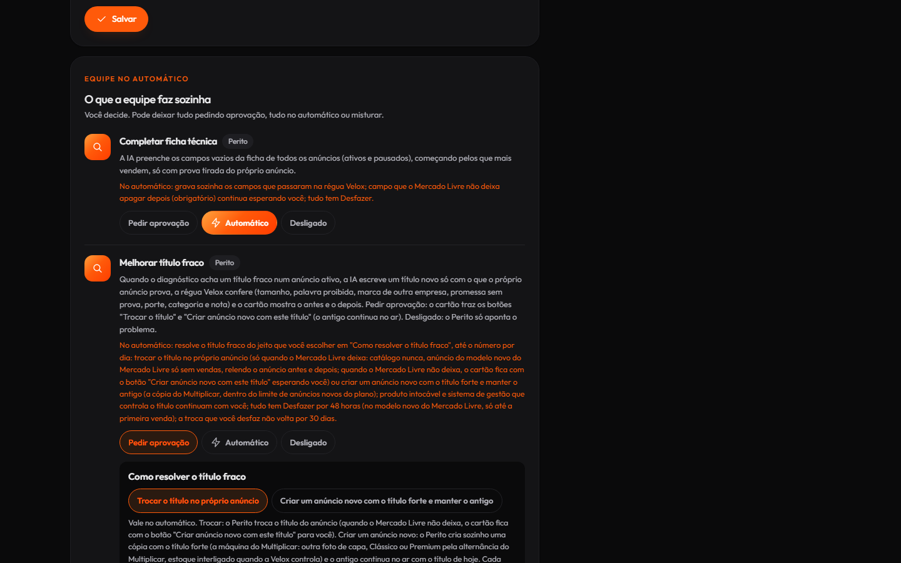

*Autonomia por função: desligado, pedir aprovação ou automático, com limite por dia e termos aceitos (dados de demonstração).*

### Cadastro automático: da planilha pro anúncio no ar

O Cadastrador transforma uma planilha em anúncios publicados.

1. **Você manda a planilha** com os produtos, e as fotos num zip, em links ou numa pasta do Google Drive. A pasta do Drive é lida a cada hora.
2. **A IA escreve o anúncio:** título, descrição e ficha técnica de cada produto. A categoria quem escolhe é o código: a coluna de categoria da planilha, um anúncio parecido da loja ou o próprio previsor de categoria do Mercado Livre.
3. **O preço sai da sua margem,** já com as taxas reais do Mercado Livre.
4. **A foto de capa é conferida** com a API de diagnóstico de fotos do Mercado Livre antes de o produto entrar na fila. Se for reprovada, o produto espera até você trocar a capa ou aceitar a sua.
5. **Os anúncios saem no modo que você escolheu:** pra você aprovar um por um, ou direto no ar, dentro do limite do dia (o padrão é 30 anúncios novos com IA por dia).

A fila anda a cada 5 segundos, e a liberação do dia acontece a cada 30 minutos. O caminho da planilha está pronto e testado, mas até 14/11/2026 nenhum lojista tinha usado em produção.

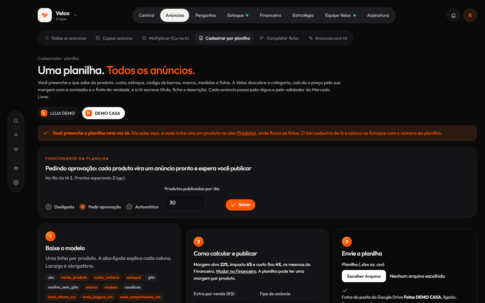

*Cadastrar por planilha: os produtos, as fotos e o modo de publicação (dados de demonstração).*

### Multiplicador de Curva A: mais vitrine pro que já vende

Curva A são os poucos anúncios que trazem a maior parte das vendas da loja. O Multiplicar coloca esses campeões em mais buscas.

1. **Ele vigia as vendas.** Quando um anúncio vende 2 unidades em 24 horas, ou 5 em 7 dias (o padrão), ele vira candidato.
2. **Cria até 2 cópias novas por rodada,** cada uma com um título próprio, pensado pra outra busca, no tipo de anúncio que o grupo tem menos. Até agora, toda rodada saiu com uma Clássico e uma Premium. O mesmo produto passa a aparecer pra mais compradores.
3. **Sem anúncio duplicado.** A Velox nunca copia um anúncio ativo igualzinho, o que o Mercado Livre trata como infração. Cada cópia tem o seu título.
4. **O estoque é um só.** O original e as cópias usam o mesmo estoque, então não existe venda de produto que acabou.
5. **Espera 7 dias** depois da última cópia, e só faz a próxima rodada se o gatilho de vendas continuar valendo, até 4 cópias no padrão.

Até 14/11/2026, o Multiplicar publicou **33 cópias** nas lojas conectadas.

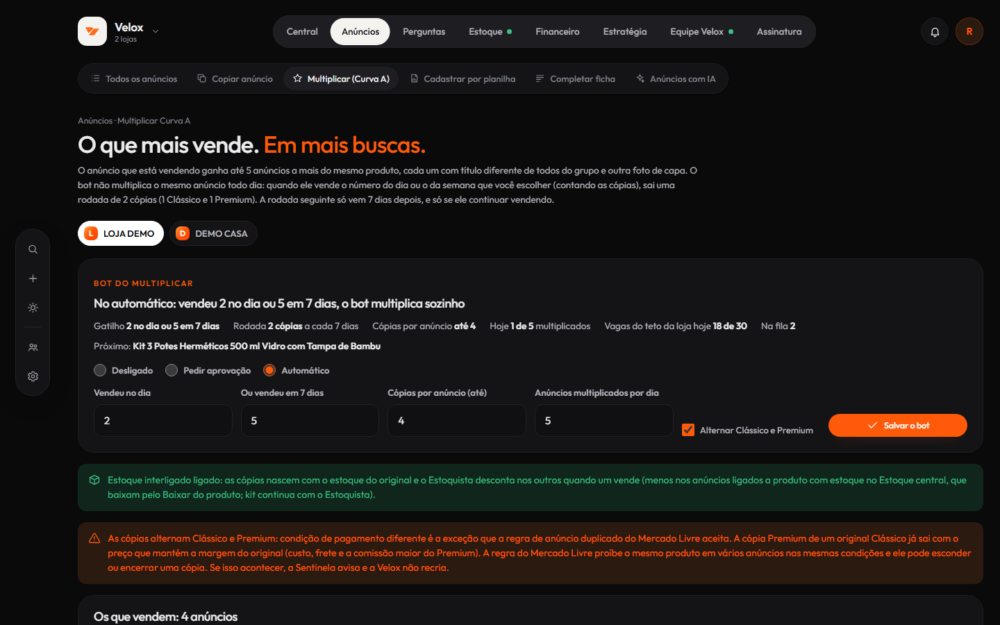

*Multiplicar Curva A: os anúncios que vendem e as cópias pra outras buscas (dados de demonstração).*

### Dentro das regras do Mercado Livre

A Velox foi feita pra trabalhar dentro das regras, sem forçar a plataforma.

- **Só a API oficial e o login oficial.** O lojista conecta a loja na tela do próprio Mercado Livre, e a Velox nunca vê a senha. Os tokens ficam cifrados.
- **Abaixo do limite, com teto próprio.** O Mercado Livre permite 18.000 chamadas por hora pro app inteiro, ou seja, 300 por minuto. A fila da Velox tem um teto próprio de cerca de 285 por minuto, então fica abaixo do limite.
- **Freia sozinha.** Se o Mercado Livre pede calma (erro 429) ou fica instável, a fila para por 5 minutos. Nos 7 dias até 10/11/2026, isso aconteceu 1 vez.
- **Dados sempre frescos.** O token é renovado a cada 30 minutos, e os dados da loja nunca ficam com mais de 6 horas, como as regras pedem.
- **Nada proibido.** A Velox nunca faz busca por vendedor e nunca cria anúncio duplicado.
- **Toda alteração é controlada.** Ou com a sua aprovação, ou no automático com limite por dia, e sempre com o valor anterior guardado.

E ainda tem o Atendente respondendo perguntas, o Vigia do Frete protegendo a margem, o Perito melhorando ficha e título, o Recuperador refazendo anúncio derrubado e o Estoquista cuidando do estoque central. Tudo isso está em [Os agentes de IA](#os-agentes-de-ia).

**Tudo o que está descrito aqui roda em produção,** e os 2.329 testes automáticos do app passam (em 14/11/2026).

## Num relance

| Número | O quê | Data |
|---|---|---|
| **26 + 30** | 26 agentes de IA e 30 robôs de regra trabalhando em turnos de 24 horas ([catálogo em inglês](docs/agents.md)) | em 14/11/2026 |
| **7** | lojas do Mercado Livre conectadas | em 14/11/2026 |
| **272** | anúncios monitorados, em 3 lojas | em 14/11/2026 |
| **34** | anúncios publicados pelo sistema (33 cópias feitas pelo Multiplicar, 1 anúncio refeito pelo Recuperador) | em 14/11/2026 |
| **1.555** | registros de atividade da equipe da loja (desde 2 de outubro) | em 14/11/2026 |
| **894** | chamadas de IA registradas pelo app (desde 1º de outubro); as 557 que passaram pela API custaram US$ 14,02 no total | em 14/11/2026 |
| **38** | matérias publicadas pelo jornal de IA (desde 14 de outubro) | em 14/11/2026 |
| **11** | posts no Instagram publicados pelo sistema (9 carrosséis e 2 Reels, de 3 a 9 de novembro) | em 14/11/2026 |
| **12** | workflows no n8n | em 14/11/2026 |
| **75.456** | linhas de TypeScript no app principal (264 arquivos), com 107 arquivos de teste | em 14/11/2026 |
| **135 / 91** | tabelas no banco / migrations SQL | em 14/11/2026 |
| **0** | clientes pagantes. Receita de clientes: R$ 0 | em 14/11/2026 |

## O problema

Vender no Mercado Livre, o maior marketplace da América Latina, dá muito trabalho repetitivo. Alguém precisa escrever anúncios que ranqueiam, preencher fichas técnicas e responder rápido as perguntas dos compradores. Também precisa reagir quando o custo do frete muda, manter o estoque igual entre as lojas e calcular o lucro de verdade depois de tarifas, publicidade e impostos.

O pequeno vendedor faz tudo isso na mão ou paga uma agência.

## O que você recebe

A Velox é vendida como um negócio funcionando, não só como código. Cada parte abaixo existe e já rodou em produção.

| Parte | O que é | No ar desde |
|---|---|---|
| **App do vendedor** | O produto. Uma equipe da loja com 13 funcionários (5 usam IA, 6 são robôs de regra, 2 ainda estão em treinamento), mais a Central, os anúncios, as perguntas dos compradores, o estoque central, o financeiro e o caderno de regras | 01/10/2026 |
| **Integração com o Mercado Livre** | A API oficial: conexão da loja (OAuth), anúncios, perguntas, pedidos, frete, estoque, catálogo e notificações em tempo real | 01/10/2026 |
| **Painel do admin** | Clientes, custo de IA por cliente, atividade ao vivo, os agentes das lojas de todos os clientes, servidor e backups, login da equipe com 2FA | 13/10/2026 |
| **Site com teste grátis e cobrança** | [veloxsolution.com.br](https://veloxsolution.com.br): teste grátis de 7 dias e cobrança automática por Pix ou cartão pelo Asaas | 21/10/2026 |
| **Jornal de IA** | Velox Notícias: pesquisa, redação, revisão por um segundo modelo, publicação e alertas por e-mail | 14/10/2026 (primeira matéria) |
| **Instagram no piloto automático** | Carrosséis e Reels, publicados pela API oficial da Meta | 03/11/2026 (primeiro post) |
| **Agente de WhatsApp e automações no n8n** | O João, agente de vendas e suporte, mais a jornada do teste, os lembretes de cobrança e os alertas internos | n8n no servidor desde 28/10/2026 |
| **Andar de crescimento** | 10 agentes de IA pra aquisição paga no Meta Ads. Só um robô de regra tem permissão pra agir na Meta | 03/11/2026 |
| **Velox AI HQ** | Um escritório em pixel art que mostra o estado real de cada agente | Dentro do admin |
| **Marca e domínio** | O nome Velox Solution (sem registro no INPI), o domínio veloxsolution.com.br (transferido pro comprador no Registro.br), a conta do Instagram e a página do Facebook (o comprador vira administrador) | Na entrega |
| **Material de entrega** | Um repositório de código privado (cerca de 1.800 arquivos, com os 12 workflows do n8n exportados e sem dados de clientes), um guia de instalação passo a passo e vídeos tutoriais dentro do app | 14/11/2026 |

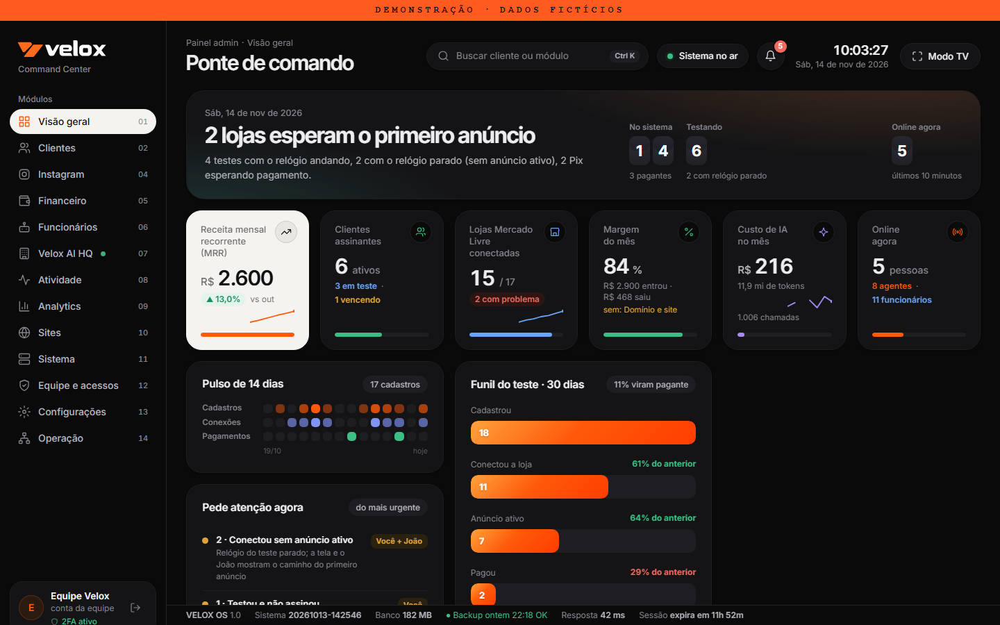

*Visão geral do painel do admin. Dados de demonstração: todos os clientes e todos os valores desta tela são fictícios, inclusive a receita.*
O admin também mostra os agentes das lojas de todos os clientes, o custo de IA por cliente, a saúde do servidor e os backups, a atividade ao vivo e os logins da equipe com 2FA. Todas as telas do admin estão em [docs/screens.md](docs/screens.md#admin-command-center) (em inglês).

## Integração com o Mercado Livre

Esse é o coração da Velox. Tudo passa pela API oficial do Mercado Livre.


*O vendedor conecta a loja na tela de login do próprio Mercado Livre. A Velox nunca vê a senha (dados de demonstração).*

### Conectar a loja

- **OAuth.** O vendedor entra na tela oficial do Mercado Livre e autoriza o app da Velox.
- **Tokens criptografados.** Os tokens ficam guardados criptografados com AES-256-GCM. A chave só existe no servidor.
- **Renovação.** Uma rotina roda a cada 30 minutos. Ela renova qualquer conta com token vencendo em menos de 70 minutos, ou que não foi renovada nos últimos 3 dias.
- **Vigilância.** O Plantão dispara um alerta se o acesso de uma loja estiver vencido há mais de 15 minutos.

### Ler a loja

- **Primeira leitura.** Logo depois da conexão, a Velox carrega anúncios, qualidade, tarifas e vendas. Leva alguns minutos.
- **Fila de leitura.** Uma leitura por vez, checada a cada 3 segundos. Uma loja pode ter no máximo uma leitura pendente ou rodando (um índice único parcial no PostgreSQL garante isso).
- **Dados nunca com mais de 6 horas.** As regras do Mercado Livre pedem dados com no máximo 6 horas. Um agendador checa a cada 5 minutos e coloca a loja de volta na fila 5 h 30 min depois do início da última leitura boa. Isso dá umas 4 leituras por loja por dia.
- **Volume.** 536 leituras desde 15 de outubro (a tabela guarda 30 dias), em 14/11/2026.

### Notificações em tempo real (webhooks)

- **Tópicos:** `items`, `items_prices`, `orders_v2` e `questions`.
- **Caixa de entrada primeiro.** Cada notificação é guardada antes de qualquer outra coisa, então um processamento lento nunca perde um evento. São aceitas até 120 por minuto, por conta e por tópico.
- **Processamento.** A cada 15 segundos, em lotes de 50. Se der erro, a Velox tenta de novo depois de 2, 4, 8 e 16 minutos, e desiste na 5ª tentativa.

### Anúncios

- **Nota Velox.** Todo anúncio recebe uma nota de 0 a 100 (título, ficha técnica, descrição, fotos). A nota é código puro, sem IA.
- **Ficha técnica.** A IA só propõe valores que consegue provar pelo anúncio, e mostra o trecho exato que prova cada um. Ela nunca inventa um código de barras ou uma marca. As recusas do Mercado Livre aparecem do lado do resultado.
- **Títulos.** Títulos fracos ganham uma versão melhor, que segue as regras de título do marketplace.
- **Anúncios novos por planilha.** As fotos vêm num zip, como links ou de uma pasta do Google Drive. A categoria vem do código (a coluna da planilha, um anúncio parecido ou o previsor de categoria do Mercado Livre). O preço sai da margem desejada, com as tarifas reais. A foto de capa passa pela API de diagnóstico de fotos do Mercado Livre antes de o produto entrar na fila.
- **Multiplicar o que vende.** Quando um anúncio vende 2 unidades em 24 horas ou 5 em 7 dias, a Velox faz até 2 cópias por rodada, com títulos pra outras buscas. A próxima rodada só sai 7 dias depois, e só se o gatilho de vendas continuar valendo.
- **Recuperação.** Quando o Mercado Livre derruba um anúncio, o Recuperador monta um substituto com IA e pesquisa de mercado. Por padrão, o vendedor aprova antes de ir pro ar.
- **Catálogo oficial.** O Copiador pode levar um anúncio pra página oficial do catálogo, pelo caminho oficial.
- **Sem anúncio duplicado.** A Velox nunca copia um anúncio ativo como duplicado, o que o Mercado Livre trata como infração. Cada cópia ganha um título próprio, pra uma busca diferente.

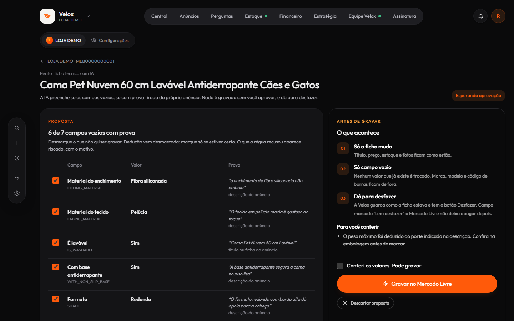

*Ficha técnica proposta pela IA: cada valor vem com o trecho exato que prova esse valor (dados de demonstração).*

### Perguntas dos compradores

- Uma notificação de pergunta aciona o Atendente. Ele escreve uma resposta a partir do anúncio, do caderno da loja e de respostas anteriores.
- Uma varredura roda a cada 3 minutos. Uma pergunta que esperou mais de 1 hora vira um aviso pro vendedor.
- No modo automático, só saem as respostas marcadas como "confiante". Elas esperam 3 minutos antes, pro vendedor poder segurar. O resto vai pra fila "Precisa de você".

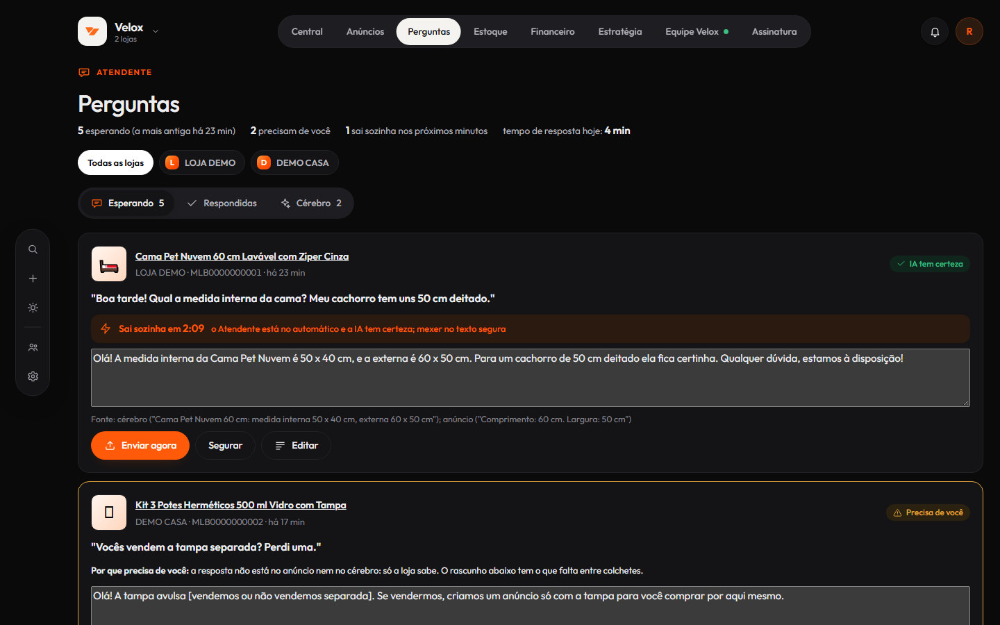

*Perguntas dos compradores: respostas prontas, uma contagem regressiva antes do envio automático e as que precisam do vendedor (dados de demonstração).*

### Pedidos e estoque central

- **Vendas ao vivo.** Uma notificação de pedido atualiza o estoque central e os números do financeiro.
- **Estoque central.** Um produto, todos os anúncios em todas as lojas e todas as cópias. As movimentações de estoque ficam num registro que só aceita linhas novas (append-only), com chave de idempotência, então um clique duplo conta uma vez só.
- **Varreduras de reserva.** As vendas são conferidas de novo a cada 3 minutos (até 15 dias pra trás). Os cancelamentos são conferidos a cada 30 minutos.
- **Volume.** 175 pedidos lidos e 190 atualizações de estoque enviadas ao Mercado Livre desde 14 de outubro, em 14/11/2026.

### Frete

- Quando o custo do frete grátis de um anúncio sobe, o Vigia do Frete calcula o preço que mantém a margem.
- No modo automático, ele sobe o preço no máximo 15% por vez (o padrão), e só se o frete subiu pelo menos R$ 1 por venda. Ele nunca baixa um preço.
- O Plantão sinaliza qualquer anúncio que teve o preço aumentado 3 vezes ou mais em 7 dias.

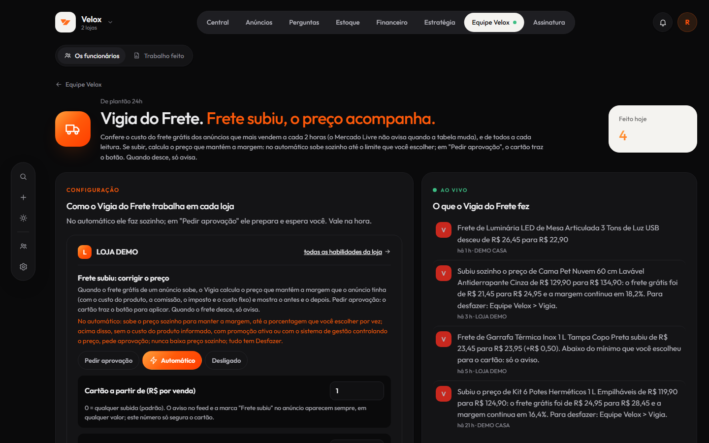

*Vigia do Frete: quando o custo do frete grátis sobe, ele reajusta o preço pra manter a margem, com Desfazer (dados de demonstração).*

### Limites de chamadas e pausas (backoff)

- O Mercado Livre permite 18.000 chamadas por hora pro app inteiro. A fila da própria Velox nunca passa de umas 285 chamadas por minuto.
- Num 429, num 5xx, numa falha de rede ou num timeout, a fila de leitura para por 5 minutos.
- Nos 7 dias até 10/11/2026, o Mercado Livre pediu uma vez pra Velox ir mais devagar.
- A Velox nunca faz busca por vendedor, o que os termos da plataforma proíbem.

### Alterações: aprovação primeiro, automático só com limite

- Alterações num anúncio só acontecem com a aprovação do vendedor, ou no modo automático com os termos aceitos e um limite diário.
- O modo automático exige os termos aceitos. Preços, títulos e respostas automáticas pedem, cada um, mais um aceite próprio.
- Limite padrão: 30 ações automáticas por loja por dia. O vendedor pode escolher de 1 a 500. Ficha técnica e títulos têm os próprios números diários.
- Durante o teste grátis, Multiplicar, Recuperador, Frete e Perguntas ficam em "pedir aprovação".
- Se o vendedor diz que um ERP gerencia a loja, a Velox obriga a aprovação pra Multiplicar, Recuperador e Catálogo.
- Toda alteração guarda o valor anterior. Mudanças de preço e de ficha técnica têm um botão Desfazer.

## Os agentes de IA

Em 14/11/2026: **26 agentes de IA e 30 robôs de regra** trabalhando em turnos de 24 horas. Um agente de IA chama um modelo de linguagem. Um robô de regra roda regras fixas, sem modelo de linguagem.

| Área | O que os agentes de IA fazem | O que os robôs de regra fazem | Quem vê |
|---|---|---|---|
| **Lojas do vendedor** | Ficha técnica e títulos, anúncios novos, cópias, anúncios refeitos, respostas pros compradores | Vigiam os anúncios, margem real, plano do dia, preço com frete, relatório do dia, estoque, resultados medidos 14 dias depois | O vendedor |
| **Jornal** | Escolhem a pauta, escrevem a matéria, julgam a matéria contra as fontes | Rodam o motor de missões, leem as fontes, publicam a versão aprovada, medem, desenham a arte, avisam os buscadores, mandam os alertas | Interno |
| **Instagram** | Escrevem carrosséis e Reels, revisam no Conselho de Vendas, aprendem com Reels anteriores, análise semanal | Publicam, leem métricas, leem posts de concorrentes | Interno |
| **WhatsApp e cobrança** | João (vendas e suporte), leitor de comprovante Pix | Jornada do teste, lembretes de assinatura, relógio do teste, cobranças abandonadas, conciliação com o Asaas | Leads e clientes falam com o João |
| **Site** | Assistente do site no balão de chat | Vigia do site | Visitantes |
| **Crescimento (Meta Ads)** | 10 agentes: direção, pesquisa, posicionamento, copy, roteiros, QA, compra de mídia, dados, aprendizado, ativação | Medidor do funil, tesouraria, executor de campanhas | Interno |
| **Operação** | | Plantão, com 8 vigias, e vigia de WhatsApp travado | Interno |

O vendedor vê 13 funcionários na tela da equipe. Só 5 deles usam IA:

| Funcionário | Usa IA | Modos |
|---|---|---|
| Perito | Sim (ficha técnica e títulos; a nota em si é código puro) | Ficha técnica e títulos: desligado, aprovação ou automático |
| Recuperador | Sim | Desligado, aprovação ou automático |
| Cadastrador (planilha e Multiplicar) | Sim | Desligado, aprovação ou automático |
| Copiador | Sim (cópias); a etapa do catálogo é código puro | Catálogo: desligado, aprovação ou automático |
| Atendente (com o Cérebro da loja) | Sim | Desligado, aprovação ou automático |
| Sentinela | Não | Sem modo: roda depois de cada leitura da loja |
| Financeiro | Não | Avisar ou desligado |
| Estrategista | Não | Sem modo: uma vez por dia por loja |
| Vigia do Frete | Não | Desligado, aprovação ou automático |
| Relator | Não | Avisar ou desligado |
| Estoquista | Não | Estoque central: modo automático disponível |
| Radar | Em treinamento: ainda não roda | |
| Expedidor | Em treinamento: ainda não roda | |

O catálogo completo, com gatilhos, modos, modelos e trabalho feito até agora: **[docs/agents.md](docs/agents.md)** (em inglês).

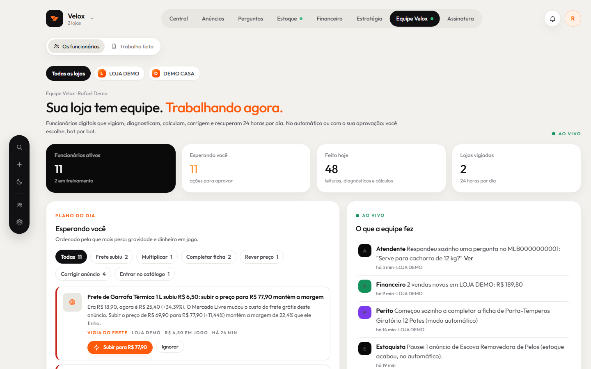

*A tela da equipe: funcionários ativos, a fila de aprovação e a atividade ao vivo (dados de demonstração).*

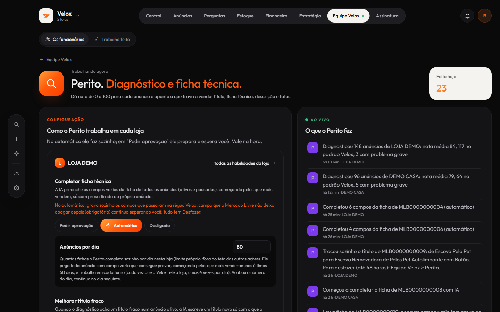

*Perito: dá uma nota de 0 a 100 pra cada anúncio, preenche a ficha técnica com prova e melhora títulos fracos (dados de demonstração).*

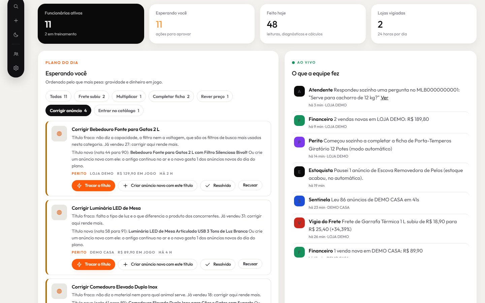

*Fila de aprovação ("Precisa de você"): o antes e o depois de cada mudança, com Aprovar, Resolvido e Recusar (dados de demonstração).*


*Autonomia por habilidade: desligado, pedir aprovação ou automático, com limites diários e termos aceitos (dados de demonstração).*

### Financeiro e o caderno de regras

- **Financeiro.** As vendas brutas batem com o que o Mercado Livre informa (inclui pedidos cancelados depois do pagamento). O lucro líquido por venda e por anúncio sai depois do custo do produto, tarifas, frete, publicidade, despesas fixas e imposto interestadual (o DIFAL).
- **Caderno de regras.** Cada loja tem um caderno: como a loja funciona, o que vende e as regras que todo agente precisa seguir. O Atendente aprende fatos com as respostas que manda, e o vendedor confirma o que ele aprendeu.

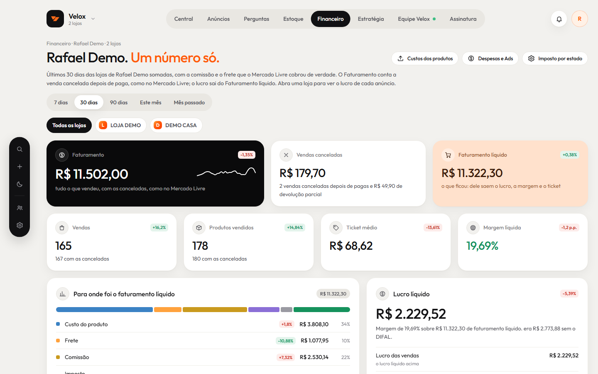

*Financeiro de todas as lojas: o bruto do jeito que o Mercado Livre informa, o líquido e pra onde foi o dinheiro (dados de demonstração).*

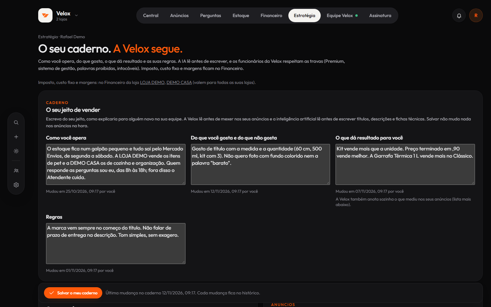

*O caderno do vendedor: como a loja funciona, o que vende e as regras que todo agente precisa seguir (dados de demonstração).*

## A equipe de 24 horas

A Velox trabalha dia e noite. Alguns exemplos:

- **A cada 3 segundos:** a fila de leitura das lojas anda.
- **A cada 15 segundos:** as notificações do Mercado Livre são processadas, e as respostas confiantes que já esperaram 3 minutos saem.
- **A cada 3 minutos:** varredura das perguntas dos compradores e das vendas do estoque.
- **A cada 30 minutos:** os tokens são renovados e o custo do frete é checado.
- **Todo dia às 3h:** backup criptografado do app, do n8n e do gateway de WhatsApp.
- **Todo dia, das 8h às 20h:** o jornal pode publicar até 6 matérias, com 2 horas de intervalo.
- **Dias úteis às 8h, 12h e 18h30:** posts do Instagram, 15 por semana.
- **O tempo todo:** o Plantão checa 8 sinais de falha a cada 10 minutos.

A agenda completa, com o que roda, quando e quem: **[docs/24-hours.md](docs/24-hours.md)** (em inglês).

## Site, teste grátis e cobrança


*O site público: "Sua loja não pode depender de você pra tudo", com o teste grátis de 7 dias (dados de demonstração no painel desenhado).*

- **Site.** HTML, CSS e JavaScript estáticos, sem framework. Uma página de vendas, uma calculadora grátis do Mercado Livre, 6 páginas (uma por função, geradas por um script), política de privacidade, termos e um aviso de cookies. Um assistente de IA atende os visitantes no balão de chat.
- **Medição.** O Pixel da Meta e a API de Conversões do servidor só funcionam depois que o visitante aceita os cookies, e o aceite fica registrado. A Velox também conta as próprias visitas com um ID de visitante diário em hash e sem endereço IP.
- **Teste grátis.** "Testar 7 dias na minha loja" abre o cadastro dentro do app. Sem cartão, uma loja. Os 7 dias só contam enquanto a loja tem um anúncio ativo. O teste tem um orçamento de IA de R$ 15 no total.
- **Cobrança.** Pix na tela, ou cartão na janela segura do Asaas. Sem contrato. O acesso é liberado sozinho quando o Pix cai. Cancela com um clique; o que foi pago continua ativo até o fim do período.
- **Checagens em segundo plano.** Cada evento do Asaas é processado uma vez só. As assinaturas são relidas no Asaas a cada 3 horas. Um Pix não pago é cancelado 5 dias depois do vencimento, e um cartão que falha por 7 dias também é cancelado.
- **Comprovantes Pix no WhatsApp.** A IA só transcreve o comprovante. Quem decide é o código: Pix concluído, valor do plano, Velox como recebedora, data dentro de 48 horas e um ID no formato do Banco Central. Ela nunca libera acesso sozinha.

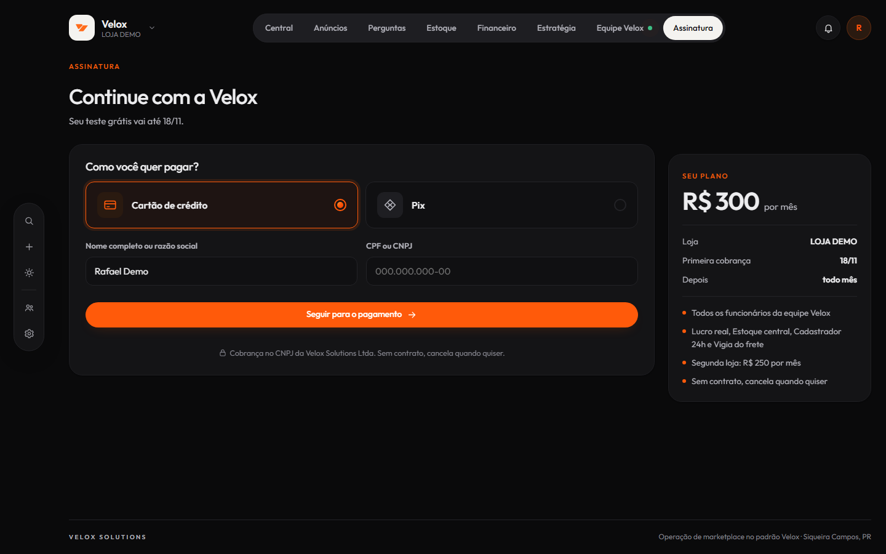

*Assine com cartão ou Pix, sem contrato, cancele quando quiser (dados de demonstração).*

## Jornal no piloto automático

Velox Notícias (blog.veloxsolution.com.br) é um site de notícias sobre marketplaces, escrito e publicado por agentes de IA.

1. **Fontes.** Um robô lê só feeds cadastrados e permitidos, com requisições GET simples, e respeita o robots.txt. São 28 fontes públicas (veículos de notícia e órgãos oficiais); 779 itens coletados até 14/11/2026.
2. **Pauta.** O pesquisador (Claude Haiku 5.5) propõe 3 ideias de pauta e escolhe uma, dizendo por quê. Cada ideia precisa de 2 fontes. Sem 2 itens novos, a missão para antes de chamar a IA.
3. **Redação.** O redator de SEO (Claude Haiku 5.5) escreve uma matéria original de 600 a 1.200 palavras e guarda como uma proposta versionada, com hash.
4. **Checagens anticópia, em código.** Nenhuma sequência de 10 palavras seguidas igual ao resumo de uma fonte. Nenhuma sequência de 6 palavras seguidas igual ao título de uma fonte. Regras de escrita da casa. Limite honesto: a checagem compara com o título e o resumo que a Velox coleta, não com a matéria original inteira.
5. **Juiz editorial em outro modelo.** O supervisor editorial (Claude Sonnet 5.5) confere cada afirmação contra as fontes. Ele aprova, devolve, rejeita ou pede uma decisão humana. Se um dia o juiz e o redator forem o mesmo modelo, a aprovação vira uma decisão humana. No máximo 3 devoluções por matéria.
6. **Publicação.** O publicador só solta a versão aprovada exata, conferida pelo hash. Entre 8h e 20h, no máximo 6 por dia, com 2 horas de intervalo. A aprovação final é uma configuração: desde 29/10/2026, o supervisor editorial aprova e a matéria sai sozinha. O fundador pode voltar pra aprovação humana no painel do admin.
7. **Depois de publicar.** Cada matéria ganha a própria arte (desenhada em HTML e capturada por um Chrome headless; nada é tirado da internet), os buscadores são avisados (IndexNow e sitemap) e os alertas por e-mail vão pros assinantes.
8. **Medição.** Visitas e cliques no convite pro teste em 24 horas e em 7 dias, sem cookies e sem guardar IP.

**O processo diz não.** De 93 missões, **49 foram rejeitadas pelo próprio processo**, 6 falharam, 28 estão concluídas e 10 ainda estão sendo medidas (em 14/11/2026). O supervisor editorial fez 81 revisões: 43 aprovações, 21 devoluções, 15 rejeições e 2 decisões humanas.

**Transparência.** Uma página "Como fazemos" conta pros leitores que cada matéria é escrita por IA e conferida por outra IA contra as fontes. Também tem uma página de Correções.

Cada pauta e cada matéria têm um limite em dólar por dia e por missão, e um freio no painel do admin impede novos passos.


*Velox Notícias, o site de notícias escrito e publicado por agentes de IA (página pública).*

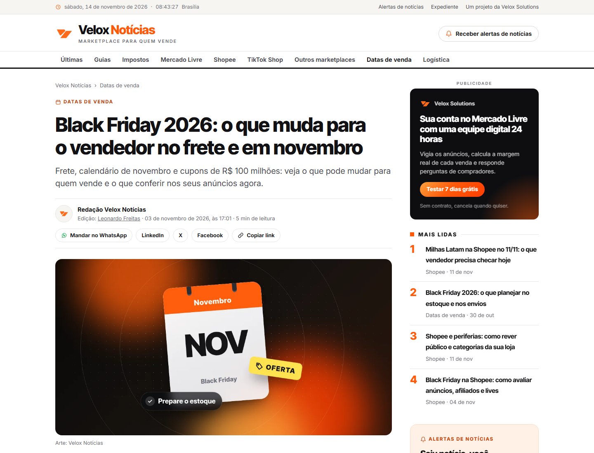

*Uma matéria do jornal de IA, com as fontes conferidas por um segundo modelo (página pública).*

## Instagram no piloto automático

A conta da própria Velox no Instagram (@veloxsolution_) é tocada por agentes de IA. Ela faz carrosséis e Reels. Não faz stories.

- **API oficial.** Os posts saem pela Instagram Content Publishing API da Meta (Graph API v24.0), com um token de usuário do sistema do portfólio empresarial da Velox. Sem senha e sem robô de navegador.
- **Redação.** O roteirista (Claude Opus 5.5) escreve os slides, a legenda, as hashtags, o texto alternativo e as fontes, ou o roteiro do Reel.
- **Checagens, depois o Conselho de Vendas.** As checagens em código rodam primeiro. Depois, o supervisor de social leva o post ao Conselho de Vendas, com 9 cadeiras de revisores de IA (psicologia, jornada do comprador, aprendizado de adultos, escuta e rapport, SPIN, gatilhos, persuasão e objeções, produto, mercado e concorrência). As cadeiras votam numa chamada só: aprovar, ajustar ou rejeitar, com vetos. Quem dá a decisão final é o código, não a IA.
- **Arte.** Um Chrome headless no servidor desenha os slides em três formatos de carrossel.
- **Sem aprovação humana.** Um post que passa nas checagens e no conselho vai direto pra fila de publicação.
- **Limites.** Até 9 produções por dia, pelo menos 4 horas entre um post e outro, e um limite diário de IA (US$ 5 em uso). A grade em uso: de segunda a sexta, às 8h, 12h e 18h30.
- **Aprendizado.** Um caçador de ganchos mantém uma biblioteca de tipos de gancho pra Reels. Um diretor de Reels lê os Reels das últimas 3 semanas e escreve o objetivo e até 6 lições pro próximo.
- **Radar de concorrentes.** Um workflow do n8n lê posts públicos de contas de referência pela Business Discovery API da Meta (oficial; até 60 contas por execução). 807 posts de 16 contas lidos até 14/11/2026.
- **Análise semanal.** Toda segunda às 7h, um workflow do n8n resume o que funcionou. O roteirista lê esse resumo.

**Números (em 14/11/2026):** 11 posts publicados de 3 a 9 de novembro (9 carrosséis e 2 Reels), 28 produções por US$ 7,49 de IA, 362 seguidores e um alcance somado de 674, com 1.192 visualizações. Nenhum post saiu de 10 a 15 de novembro: uma configuração foi gravada com aspas a mais, e a rotina entendia "geração desligada" e parava antes de chamar a IA. Foi corrigida em 14/11, e a rotina foi religada em 15/11. O próximo horário da grade é segunda, 16/11.


*Carrosséis e uma capa de Reel gerados e publicados pelo sistema pela API oficial da Meta (posts reais da conta da própria Velox).*

## WhatsApp e automações no n8n

O **João** é o agente de vendas e suporte no WhatsApp.

- Ele responde quem escreve, libera o teste grátis, recebe comprovantes Pix e ajuda os clientes depois de ler a conta deles no app.
- A base de conhecimento dele é um conjunto de Google Docs numa pasta do Drive. Mudou um documento, o João muda na hora.
- Acima de 40 mensagens por número por dia, o n8n para de chamar a IA pra aquele número e avisa o fundador.
- Se a pessoa pedir pra parar, as mensagens automáticas pra ela param.
- Modelo: Claude Sonnet 5, por um agente do n8n. O custo de IA dele não entra no registro de custos do app.

**Jornada do teste.** Sete tipos de mensagem, cada um mandado no máximo uma vez por pessoa, com texto montado pelo app (sem IA): um lembrete pra conectar a loja (1 hora, 1 dia e 4 dias depois do cadastro), uma mensagem de boas-vindas com os números da loja, um empurrãozinho depois de 2 dias sem entrar, um resumo no 5º dia só quando a equipe encontrou alguma coisa, e uma mensagem de fim de teste.

**Lembretes de cobrança.** 2 dias antes do vencimento e depois dele, às 10h, 15h e 19h. Texto do app, sem IA.

**Alertas internos.** Novos cadastros, lojas conectadas, eventos de Pix e alertas do sistema vão pro WhatsApp do fundador a cada 30 minutos, das 7h às 22h30.

**n8n.** n8n auto-hospedado no mesmo servidor, com 12 workflows (9 ativos). Os principais: o CRM (João), a jornada do teste, os lembretes de cobrança, os alertas internos e, no Instagram, publicação, métricas, radar de concorrentes e análise semanal. Os outros três estão desligados.

**O gateway.** O WhatsApp roda num gateway de WhatsApp Web no servidor, que o systemd reinicia se ele parar. A migração pra API oficial (WhatsApp Cloud API) está disponível.

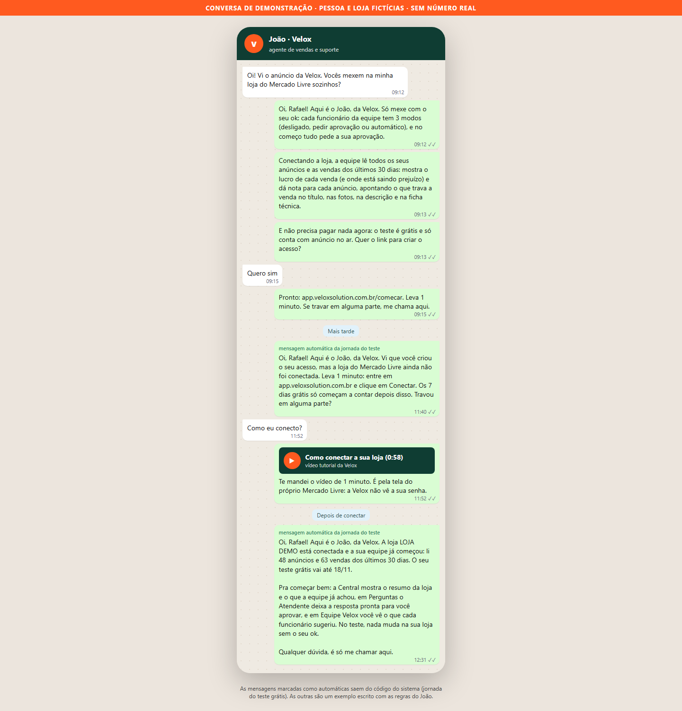

*Conversa de demonstração no WhatsApp com o João. A pessoa e a loja são fictícias; as mensagens marcadas como automáticas vêm do código real.*

## Como cada API é usada

| API | O que a Velox faz com ela |
|---|---|
| **Mercado Livre** | Conexão por OAuth; lê anúncios, pedidos, perguntas e tarifas; webhooks (`items`, `items_prices`, `orders_v2`, `questions`); grava ficha técnica, títulos, preços e estoque; publica anúncios novos e cópias; responde perguntas dos compradores; entra no catálogo oficial |
| **Anthropic Claude** | 18 rotas de tarefa entre Claude Haiku 5.5, Sonnet 5.5 e Opus 5.5, cada chamada registrada com tokens e custo. O João (n8n) usa Claude Sonnet 5, e a análise semanal do Instagram chama a API a partir do n8n |
| **Asaas** | Assinaturas por Pix e cartão, webhooks de pagamento (cada evento processado uma vez só), conciliação a cada 3 horas, cancelamento de cobranças abandonadas |
| **Meta Graph API: Content Publishing** | Publica carrosséis e Reels no Instagram |
| **Meta Graph API: Business Discovery e métricas** | Lê posts públicos de contas de referência (radar de concorrentes, até 60 contas por execução) e o alcance, os salvamentos, os compartilhamentos e os seguidores dos posts da própria Velox |
| **Meta Conversions API** | Manda eventos do site e do funil a partir do servidor, a cada 5 minutos |
| **Meta Marketing API** | Usada pelo executor de campanhas do Andar de crescimento: pausar, retomar, ajustar orçamento e criar anúncio, só com uma proposta do agente de mídia paga e um criativo aprovado pelo QA |
| **Google Drive** | Base de conhecimento do João (Google Docs) e pastas de fotos de produto pro cadastro em massa (lidas a cada hora) |
| **Resend** | E-mail transacional: alertas do jornal e redefinição de senha |
| **Gateway de WhatsApp** | Recebe e manda mensagens de WhatsApp por um gateway de WhatsApp Web, ligado ao n8n por webhook. A migração pra API oficial (WhatsApp Cloud API) está disponível |
| **IndexNow** | Avisa os buscadores de cada matéria nova |

## O prédio da Velox (Velox AI HQ)

Imagine a empresa inteira dentro de um prédio. O **Velox AI HQ** é isso: um escritório em pixel art chamado **Torre Velox**, onde cada agente aparece como um funcionário, na sala da área dele, fazendo o que está fazendo naquele momento.

Ele serve pra acompanhar a operação ao vivo: quem está trabalhando, quem precisa de uma decisão humana, quem deu erro e quem está parado.

**[▶ Veja o tour de 32 segundos pelo prédio](prints/94-hq-demonstracao.mp4)** (modo de demonstração, dados simulados).


*A Torre Velox por fora: cada andar é uma área da empresa, e as janelas acendem com a gente que está trabalhando de verdade (modo de demonstração, dados simulados).*

### Como funciona

- **O HQ mostra; quem executa são os agentes.** O trabalho acontece nas rotinas do servidor, no n8n e nos agentes de IA. O HQ lê o estado real de cada um e desenha na tela. No painel admin, dá pra decidir uma pendência direto no crachá do funcionário.
- **Regra de ouro: não inventar nada.** O que o código não consegue confirmar aparece como **"Estado desconhecido"**. A decoração nunca pisca sem dado real.
- **A animação segue a realidade.** O personagem só anda quando o estado real dele muda. O elevador só se mexe quando alguém troca de andar de verdade. A luz das janelas vem da contagem real de cada andar, e o andar com alguém precisando de você pisca em laranja.
- **De onde vêm os dados:**
  - os funcionários das lojas;
  - o João (aparece "trabalhando" se o último sinal dele tem menos de 2 minutos);
  - o passo real de cada missão do jornal;
  - o Conselho de Vendas e o Plantão;
  - as rotinas de acompanhamento, suporte, lembretes, WhatsApp, backup e n8n;
  - o Andar de crescimento e o Estúdio Instagram;
  - as sessões do Claude Code que constroem a própria Velox. O HQ lê só o estado delas, nunca o conteúdo das conversas.

### Os andares

| Andar | Área | Salas |
|---|---|---|
| Térreo | Recepção e Clientes | Central de Monitoramento, Clientes, Suporte ao cliente e a Recepção |
| 1º | Plantão e Infraestrutura | Segurança, Infraestrutura, Plantão do Sistema |
| 2º | Redação Velox Notícias | Redação |
| 3º | Comercial e Vendas | Comercial e CRM, Estratégia e Funil, Conselho de Vendas |
| 4º | Marketing e Conteúdo | Estúdio Instagram, Site e SEO, Estúdio de Reels e Vídeo, Comunidade e Engajamento |
| 5º | Lojas dos clientes | Marketplace e Automações, Mercado Ads dos clientes |
| 6º | Engenharia | Desenvolvimento, Design e UI/UX, Qualidade e Testes |
| 7º | Finanças e Governança | Inteligência, Finanças da Velox, Governança |
| 8º | Meta Ads e Crescimento | Comando do Tráfego, Inteligência e Marca, Criação de Anúncios, Mídia Paga e QA, Dados e Aprendizado, Funil e Receita |
| Cobertura | Diretoria | Diretoria e Reuniões |

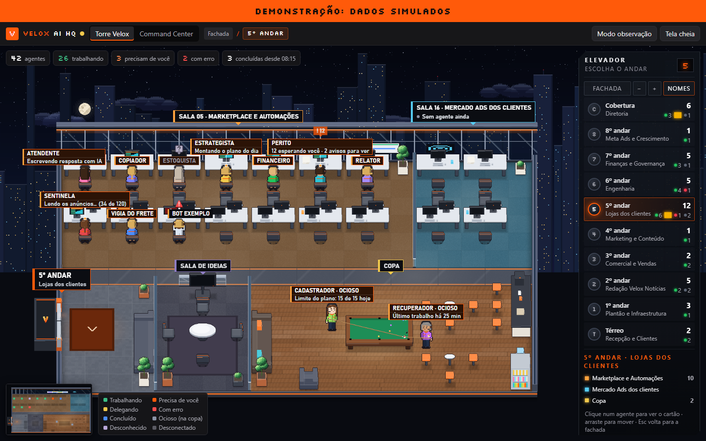

*O 5º andar, onde trabalham os funcionários das lojas: cada mesa mostra a tarefa do momento (modo de demonstração, dados simulados).*

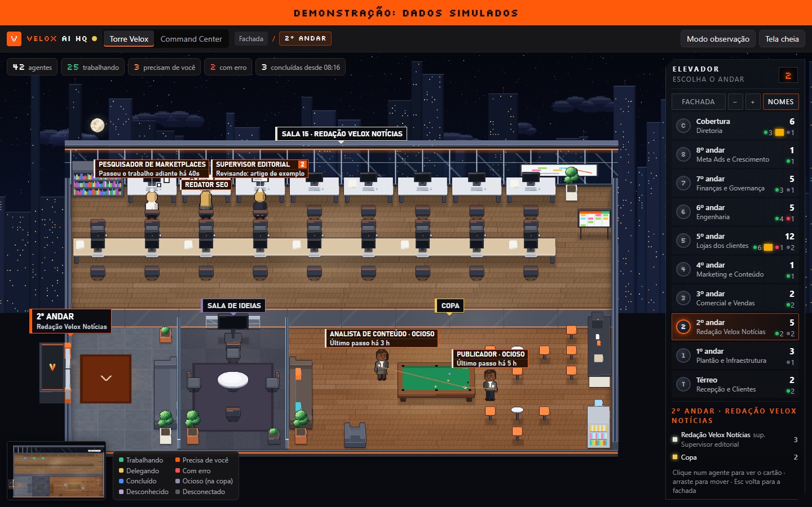

*O 2º andar, a redação: o pesquisador, o redator e o supervisor editorial (modo de demonstração, dados simulados).*

### O que aparece na tela

- **Faixa de números:** agentes, quantos estão trabalhando, quantos precisam de você, quantos deram erro e as tarefas concluídas no dia.
- **Fachada e elevador:** a torre à noite, com um botão por andar mostrando quantos estão ali.
- **Andar visto de cima:** as salas com placa, o hall do elevador e a copa, com minimapa, zoom e arrastar.
- **Personagens:** a roupa mostra a função. Os robôs usam uniforme na cor da área, as sessões do Claude Code vestem azul-marinho e coral, e os supervisores usam terno grafite com lenço laranja. Quem está ocioso vai pra copa. Quem desconectou vira uma cadeira vazia.
- **Balões:**
  - "!" quando precisa de você;
  - um check por 6 segundos quando conclui;
  - alerta vermelho quando dá erro;
  - "?" quando o estado é desconhecido;
  - uma seta quando delega trabalho, ligando quem passou a tarefa a quem recebeu, mesmo entre andares.
- **Crachá do agente:** missão, fonte, supervisor, última entrega, custo, resultado e impedimento, mais as ferramentas ativas, os contadores e a linha do tempo dele.
- **Aba Command Center:** 11 cartões de números e 4 colunas: Precisa de você, Trabalhando, Ocioso, e Desconhecido ou Desconectado.
- **Modo observação:** esconde os painéis e passeia a câmera a cada 9 segundos pelas salas onde tem gente trabalhando. Fica bom numa TV na parede.

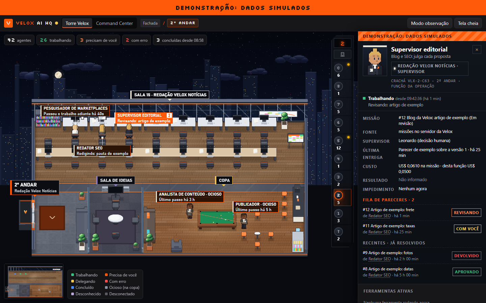

*O crachá do agente: missão, supervisor, custo, última entrega e a fila de trabalho (modo de demonstração, dados simulados).*

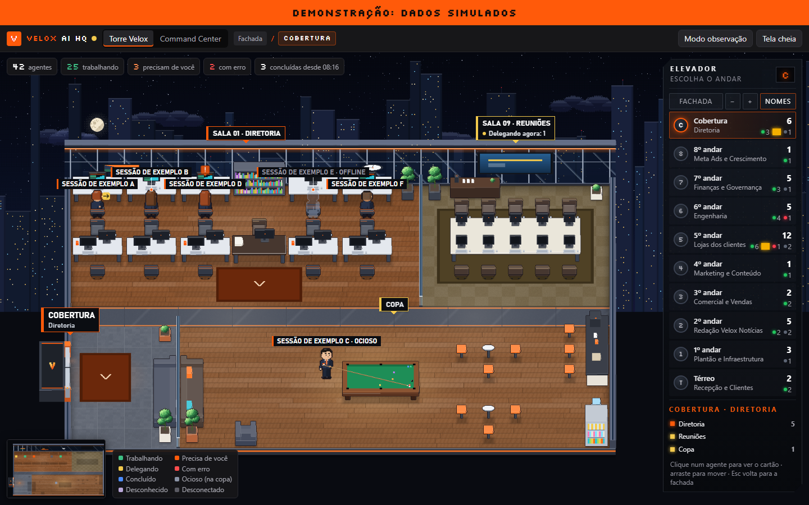

*A cobertura: a diretoria, onde as sessões do Claude Code aparecem e delegam trabalho (modo de demonstração, dados simulados).*

### Quem vê e onde roda

- **Só a equipe da Velox, dentro do painel admin.** O cliente não vê o HQ.
- **Duas versões com a mesma tela:**
  - o HQ do computador, que recebe as mudanças ao vivo por WebSocket;
  - o HQ online, dentro do painel admin, que se atualiza a cada segundo.
- **Modo de demonstração:** 42 agentes fictícios, sem rede nenhuma e com a faixa "dados simulados" sempre visível. É o que aparece nos prints e no vídeo.

### Tecnologia

React 18, TypeScript e Vite, com um motor de desenho próprio em Canvas 2D (sem motor de jogo). Desenha até 60 quadros por segundo quando algo se mexe e cai pra uns 10 quando está tudo parado, pra não pesar. São 32.583 linhas de código, com 59 arquivos de teste. Os personagens são arte própria.

## Engenharia de IA

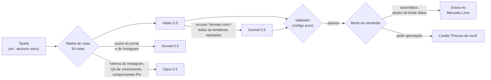

- **Uma rota por tarefa.** 18 rotas entre Claude Haiku 5.5, Sonnet 5.5 e Opus 5.5. O Haiku 5.5 faz o volume e sobe uma vez pro Sonnet 5.5 se recusar, devolver uma resposta quebrada ou se o validador rejeitar todas as tentativas dele. Os juízes do jornal e do Instagram rodam no Sonnet 5.5. O Opus 5.5 cuida da redação do Instagram, do QA de crescimento e dos comprovantes Pix.
- **Sem confiança, não sobe de modelo.** Quando o Atendente não tem certeza, ele não tenta um modelo maior. A pergunta vai pro vendedor.
- **Validadores antes de qualquer coisa chegar ao cliente.** Checagens em código puro rodam em toda saída da IA: palavras proibidas, promessas enganosas, coerência de tamanho e categoria, e regras de título do marketplace.
- **O autor nunca julga o próprio trabalho.** O juiz editorial roda num modelo diferente do redator. O QA de crescimento nunca revisa o próprio material.
- **Configurações escolhidas com testes em dados reais.** O Atendente roda no Haiku 5.5 com esforço alto e só sobe pro Sonnet 5.5 quando dá erro. Medido em produção, uma resposta do Haiku custa cerca de 1/15 de uma do Opus (amostra pequena).
- **Anúncios cerca de 13× mais baratos.** Medido em produção antes de 27/10/2026: gerar um anúncio caiu de cerca de US$ 0,12 no Opus pra cerca de US$ 0,009 no Haiku, com validadores e evals segurando a qualidade.
- **Toda chamada é registrada.** Tokens (inclusive cache) e custo, convertido pra reais pela PTAX do Banco Central daquele dia.
- **Orçamentos.** Limites padrão do plano por cliente, os valores em uso em 14/11/2026: 30 anúncios novos com IA, 30 fichas técnicas e 10 títulos por dia, 50 respostas por loja por dia, e R$ 120 de IA por mês. O teste grátis tem R$ 15 de IA no total. O motor do jornal checa um freio e um limite em dólar antes de cada passo. O Instagram tem um limite diário em dólar. O assistente do site tem um limite de US$ 3 por dia.
- **Botão de emergência.** Uma variável de ambiente pode forçar todas as rotas pra um único modelo.

**Custo de IA até agora (em 14/11/2026):** 894 chamadas registradas desde 1º de outubro, 833 delas com sucesso. 557 passaram pela API da Anthropic e custaram **US$ 14,02** no total (Opus US$ 8,46, Sonnet US$ 4,54, Haiku US$ 1,03). O maior gasto foi o Instagram pela API, de 3 a 5 de novembro: US$ 7,60. A IA ligada às lojas dos clientes custou US$ 1,40 em anúncios, US$ 0,10 em respostas e US$ 0,01 em fichas técnicas. O custo de IA do João passa pelo n8n e não está nesse total.

## Arquitetura

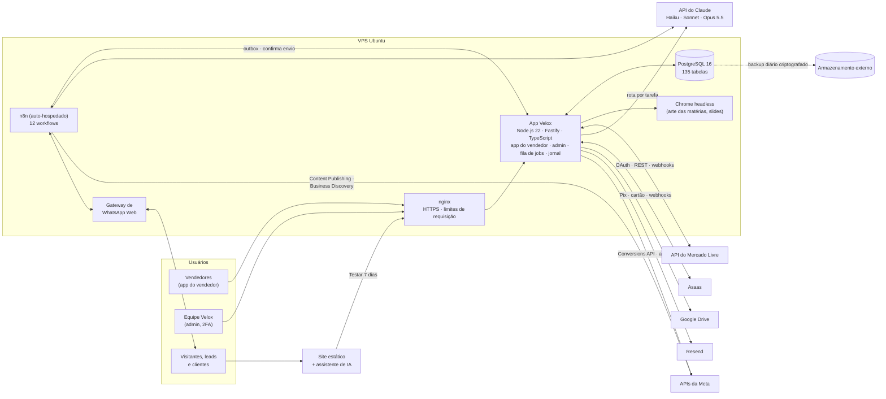

- **Um processo Node.js** (Fastify) serve o app do vendedor como HTML renderizado no servidor, mais a API do admin. O painel do admin é um app de página única em React e Vite, servido pelo mesmo app.
- **O trabalho em segundo plano** (leitura das lojas, agentes, renovação de tokens, webhooks, missões do jornal) roda no mesmo processo, numa fila de jobs em cima do PostgreSQL. Nessa escala, isso quer dizer sem Redis e menos peças pra cuidar. As rotinas nunca se sobrepõem: se a execução anterior ainda está rodando, a próxima é pulada.
- **O n8n** cuida dos workflows de mensagens e de publicação no Instagram e conversa com o app por alguns endpoints pequenos e autenticados.
- **Cada vendedor tem o próprio login** e só vê as próprias lojas. Uma instalação atende um negócio.

## Banco de dados

PostgreSQL 16 com **135 tabelas** (104 no schema principal, 11 pro Instagram, 10 pra medição do site e 10 pro Andar de crescimento), criadas por **91 migrations em SQL puro**, em 14/11/2026. Os nomes das tabelas estão em português porque o produto é brasileiro.

| Domínio | Tabelas principais | O que guardam |
|---|---|---|
| Clientes e acesso | `clientes`, `usuarios`, `sessoes`, `contas_ml`, `oauth_estados` | Clientes, logins, lojas do Mercado Livre conectadas |
| Anúncios | `anuncios`, `anuncio_grupos`, `rascunhos`, `fichas`, `catalogo` | Anúncios lidos do marketplace, grupos de original e cópias, rascunhos da IA, fichas técnicas |
| Produtos e estoque | `produtos`, `vinculos`, `movimentos` | Produtos centrais, vínculos entre anúncio e produto, o registro de estoque que só aceita linhas novas |
| Vendas e financeiro | `pedidos`, `custos`, `despesas_fixas`, `ads_dia`, `difal_aliquotas`, `frete_historico` | Pedidos, custos unitários, despesas, gasto com publicidade, alíquotas do imposto interestadual, histórico de frete |
| IA e agentes | `ia_chamadas`, `acoes`, `atividade`, `perguntas`, `cerebro`, `estrategias`, `intocaveis`, `aprendizados` | Cada chamada de IA com tokens e custo, propostas esperando aprovação, o registro de atividade, perguntas dos compradores, o caderno e as regras de cada loja, resultados medidos |
| Integrações e jobs | `sincronizacoes`, `notificacoes_ml`, `avisos_internos`, `jornada_mensagens`, `lembretes_assinatura` | Fila de leitura, caixa de entrada de webhooks, linhas de outbox consumidas pelo n8n |
| Cobrança | `asaas_cobrancas`, `asaas_eventos`, `comprovantes_pix` | Assinaturas e eventos de pagamento |
| Admin e operação | `painel_contas`, `painel_sessoes`, `painel_registro`, `missoes`, `propostas`, `execucoes` | Contas do admin com 2FA, o log de auditoria, missões dos agentes com propostas versionadas |
| Instagram | 11 tabelas num schema próprio | O motor do Instagram, incluindo a análise semanal que o roteirista lê |
| Medição do site | 10 tabelas | Visitas com um ID de visitante diário em hash, sem IP |
| Andar de crescimento | 10 tabelas | O trabalho dos agentes de crescimento |


Padrões usados:

- **Migrations versionadas.** 91 migrations em SQL puro, aplicadas em ordem por uma pequena CLI, então toda mudança de schema pode ser revisada e reproduzida.
- **Fila de jobs com deduplicação.** Um índice único parcial garante no máximo uma leitura pendente ou rodando por loja:
  ```sql
  insert into sincronizacoes (conta_id, pedida_por) values ($1, $2)
  on conflict (conta_id) where status in ('pendente', 'rodando') do nothing
  ```
- **Registro de estoque que só aceita linhas novas.** `movimentos` só recebe linhas novas. Cada linha tem uma chave de idempotência única, então um clique duplo ou uma aba duplicada conta uma vez só.
- **Caixa de entrada de webhooks.** As notificações do Mercado Livre são guardadas primeiro e processadas depois, então um processamento lento nunca perde um evento.
- **Outbox com confirmação.** O app grava as mensagens que precisam sair, com uma chave única pra que o mesmo alerta nunca entre duas vezes na fila. O n8n lê o outbox, manda cada mensagem e confirma de volta. Uma mensagem só conta como enviada depois dessa confirmação.
- **Trilha de auditoria à prova de adulteração.** As missões dos agentes guardam cada versão da proposta com um hash SHA-256, e o publicador só consegue executar o hash exato que foi aprovado. Triggers no banco bloqueiam `UPDATE`, `DELETE` e `TRUNCATE` no log de execução.

## Infraestrutura e confiabilidade

- **Hospedagem.** Uma VPS Ubuntu 24.04 com nginx como proxy reverso (HTTPS, limites de requisição). O app, o n8n e o gateway de WhatsApp rodam como serviços do systemd e reiniciam sozinhos (em 3, 5 e 10 segundos). O site é estático e fica hospedado à parte.
- **Deploy com um comando.** Ele roda os testes e para se qualquer um dos 107 arquivos de teste falhar. Depois faz o build, sobe uma pasta de release nova, troca o symlink "current" de forma atômica e reinicia o serviço. Se a checagem de saúde (`/saude`) falhar, ele **volta sozinho** pra versão anterior, em cerca de 30 a 90 segundos. O servidor guarda as 5 últimas versões.
- **Backups diários criptografados.** Todo dia às 3h: o banco do app, o n8n e o gateway de WhatsApp, em 3 arquivos criptografados. Os backups são criptografados com `age`, e só a chave pública fica no servidor, então nem quem invadir o servidor consegue ler. Ficam 8 cópias no servidor e 31 dias de cópias numa hospedagem separada, do mesmo provedor.
- **Plantão.** A cada 10 minutos, 8 vigias SQL só de leitura procuram falhas que custam dinheiro ou clientes: uma leitura de loja que falhou nas últimas 24 horas, uma resposta que não foi enviada, 3 ou mais erros de IA em 6 horas, o mesmo anúncio reajustado 3 vezes ou mais em 7 dias, uma cobrança vencida há mais de 5 dias, acesso ao Mercado Livre vencido há mais de 15 minutos, uma loja em dia sem leitura há 12 horas, e um pedido pra IA sem resposta há 30 minutos. Um alerta grave novo vai pro WhatsApp do fundador. O robô nunca conserta nada sozinho.
- **Vigia do site.** A cada 15 minutos ele checa 6 regras (entre elas: site fora do ar, o botão do teste, e-mail travado e matérias abaixo da meta), com no máximo 3 alertas por dia.
- **Acesso ao admin.** Senha mais 2FA por TOTP, sessões de 12 horas e toda ação num log de auditoria.
- **Migrações de dados seguras.** Mudanças arriscadas são ensaiadas antes, numa cópia do banco ou dentro de uma transação que é desfeita no fim.
- **Servidor.** 13 GB usados de 96 GB, em 14/11/2026. Backups de 12, 13 e 14 de novembro conferidos na pasta.

**Limites conhecidos, ditos com franqueza:**

- O WhatsApp roda num gateway de WhatsApp Web, não na API oficial. Ele ficou fora do ar de 13 a 26 de outubro e de 6 a 9 de novembro sem alerta. A migração pra API oficial (WhatsApp Cloud API) está disponível.
- O jornal, o Instagram e o Andar de crescimento podem rodar a IA num worker do Claude numa máquina desktop (como hoje) ou pela API no servidor. Em 14/11/2026, uma volta completa dos três pela API, numa cópia do banco, custou US$ 0,87. A troca é uma configuração e é feita na entrega, então o comprador não precisa de máquina desktop.
- Uma instalação atende um negócio. Não existe camada multiempresa.\n- Ainda não chega alerta no celular quando o gateway de WhatsApp cai; hoje a queda aparece no HQ e no painel do admin. O backup do gateway de WhatsApp também falhou em 6 dos últimos 10 dias. As duas correções estão na lista da entrega.

## Como eu construí

Feito com agentes de IA (Claude Code) sob a minha direção. O produto, as decisões de arquitetura, o QA e a operação em produção são responsabilidade minha. Agentes de IA de programação escrevem a maior parte do código; eu dirijo, reviso e testo.

O trabalho anda em **ondas**:

1. Combinar o escopo.
2. Aprovar um protótipo clicável.
3. Entregar em pedaços pequenos.
4. Testar numa loja real.
5. Consertar o que quebra e começar a próxima onda.

Entregas grandes passam por revisões independentes antes de ir pro ar. 107 arquivos de teste com 2.329 testes protegem o app principal (todos passando em 14/11/2026), e o deploy é bloqueado se qualquer um deles falhar.

| Parte | Tamanho (em 14/11/2026) |
|---|---|
| App principal | 75.456 linhas de TypeScript em 264 arquivos; 107 arquivos de teste (35.389 linhas) |
| Painel do admin | 18.557 linhas; 14 arquivos de teste |
| Velox AI HQ | 32.583 linhas; 59 arquivos de teste |
| Site | 5.853 linhas de HTML, CSS e JS em 69 arquivos, mais um gerador de páginas de 1.250 linhas |
| Scripts do servidor | 2.559 linhas |
| Total | cerca de 177.000 linhas, contando testes, comentários e linhas em branco |

## Linha do tempo

| Data (2026) | Marco |
|---|---|
| Agosto | A Velox começa como um serviço de gestão de lojas pra vendedores do Mercado Livre |
| 1º de setembro | Criadas a base de conhecimento do agente de WhatsApp e as tabelas do CRM |
| 30 de setembro | Servidor provisionado; começa a construção da plataforma |
| 1º de outubro | Plataforma no ar; primeiro anúncio publicado pelo sistema |
| 6 de outubro | Primeira loja real conectada (uma loja piloto, tocada pela equipe da Velox) |
| 13 de outubro | A Velox vira só software (SaaS); painel do admin no ar |
| 14 de outubro | Primeira matéria do jornal de IA |
| 21 de outubro | Site novo, com teste de 7 dias que o próprio cliente ativa e cobrança automática |
| 23 de outubro | Primeiros cadastros de usuários de fora, pelo site |
| 28 de outubro | n8n auto-hospedado vai pro servidor |
| 1º de novembro | Gateway de WhatsApp vai pro servidor |
| 3 de novembro | Primeiro post do Instagram no piloto automático; o Andar de crescimento começa |
| 9 de novembro | Meta Ads pausado pelo fundador; último post do Instagram antes de uma pausa causada por um erro de configuração (corrigido em 14/11, rotina religada em 15/11) |

## Resultados

Números honestos, em 14/11/2026. Eles são da fase de lançamento e testes, desde que o sistema foi ao ar (1º de outubro de 2026), com a loja piloto e as contas de teste grátis. Mostram o sistema funcionando de verdade, em lojas reais do Mercado Livre.

**Negócio**

- **Ainda sem clientes pagantes. Receita de clientes: R$ 0.** O único Pix que a Velox recebeu foi um teste de R$ 5,00 do próprio fundador, em 21 de outubro.
- 11 cadastros: 1 loja piloto (conectada em 6 de outubro e tocada pela equipe da Velox, não é cliente pagante) e 10 pelo site, de 21 de outubro a 6 de novembro (um deles, teste do próprio fundador).
- Dos 10 cadastros pelo site, 6 conectaram uma loja, e só 2 dessas lojas têm anúncios. 4 testes estão abertos, todos com o relógio do teste pausado porque não têm anúncio ativo. 1 teste acabou sem pagamento. 3 contas foram canceladas.
- **7 lojas do Mercado Livre conectadas** (a piloto e 6 de cadastros pelo site).

**Trabalho feito pelos agentes**

- 272 anúncios monitorados (232 ativos, 39 pausados, 1 em revisão) em 3 lojas.
- 34 anúncios publicados pelo sistema: 33 cópias feitas pelo Multiplicar e 1 anúncio refeito pelo Recuperador. Nenhum por planilha ainda.
- 1.555 registros de atividade da equipe da loja desde 2 de outubro. Os maiores: Perito 366, Financeiro 358, Sentinela 315, Relator 147.
- 99 ações propostas pra aprovação: 13 feitas, 29 resolvidas, 57 ainda pendentes.
- 190 atualizações de estoque enviadas ao Mercado Livre desde 14 de outubro; 175 pedidos lidos; 147 relatórios do dia.
- 29 perguntas de compradores lidas: 3 respondidas pela Velox, 24 respondidas pelo vendedor direto no Mercado Livre, 2 sem resposta.

**Conteúdo e tráfego**

- Jornal: 38 matérias (de 14 de outubro a 14 de novembro, 760 palavras em média). 52 visitas pela contagem do próprio jornal, de 14 de outubro a 12 de novembro, e 0 cliques no convite pro teste. 1 assinante por e-mail.
- Site: 286 visitantes e 11 cliques em "testar" de 1º a 13 de novembro.
- Instagram: 11 posts, 362 seguidores.
- Meta Ads, de 3 a 9 de novembro: R$ 76,22 gastos, 12.030 impressões e 305 cliques no link. Pausado desde 9 de novembro. O Andar de crescimento rodou 84 rodadas de 3 a 14 de novembro, e a Meta confirmou 12 ações que vieram pelo fluxo dos agentes (6 anúncios criados, 6 pausados).

**Das primeiras semanas (outubro de 2026)**

- O faturamento do mês da loja piloto na Velox bateu centavo por centavo com o relatório oficial do Mercado Livre.
- Na primeira leitura da loja piloto, a Velox achou uma campanha de publicidade rodando havia mais de um mês sem o dono saber.

## O que eu aprendi

- **Produto pronto é metade do caminho.** O jornal publicou 38 matérias no primeiro mês, num site novo, e tráfego orgânico leva tempo. Quem comprar a Velox recebe a máquina pronta e testada; o próximo passo é a distribuição: anúncios e vendas.
- **Um modelo pequeno com bons validadores e evals de verdade ganha de "sempre usar o maior modelo".** Os anúncios ficaram cerca de 13× mais baratos, com as mesmas decisões.
- **Nem tudo precisa de IA.** 6 dos 11 funcionários da loja que estão trabalhando são regras puras, sem modelo de linguagem. A IA escreve e acha a prova; o código faz a conta e aplica os limites.
- **Deixe o usuário escolher a autonomia.** Desligado, aprovação ou automático por habilidade deixa o vendedor começar com aprovações e passar adiante só o que ele confia.
- **Confira contra a fonte da verdade.** Bater com os números do próprio marketplace mostrou que as vendas brutas dele incluem pedidos cancelados depois do pagamento. Sem essa checagem, ia parecer um bug na frente de um cliente.
- **Teste o alerta, não só a coisa que ele vigia.** O gateway de WhatsApp caiu duas vezes sem nenhum alerta chegar no celular. Um vigia só serve se o caminho do alerta dele funciona.
- **Nenhuma máquina sozinha deveria segurar o negócio.** Quando um worker de desktop parou por um dia, o jornal, o Instagram e o Andar de crescimento pararam junto.

## A Velox está à venda

A Velox está à venda por inteiro: o produto, a marca e a máquina em volta dele.

**O que vem no pacote**

- O app do vendedor e a integração com o Mercado Livre, com o código-fonte completo num repositório privado.
- O painel do admin e o Velox AI HQ.
- O site com o teste grátis e a cobrança automática (Asaas).
- O jornal de IA (Velox Notícias) e o Instagram no piloto automático.
- O João no WhatsApp e as automações no n8n.
- O Andar de crescimento pro Meta Ads.
- A marca e o domínio: o nome Velox Solution (sem registro no INPI), o domínio veloxsolution.com.br, transferido no Registro.br, e a conta do Instagram e a página do Facebook, com o comprador como administrador.
- Um guia de instalação passo a passo, incluindo como criar uma chave de backup nova e testar uma restauração.

**Entrega**

Eu instalo tudo no seu servidor e nas suas contas e deixo rodando e testado, em cerca de 5 dias úteis.

- Você cria as suas próprias contas: servidor, app de desenvolvedor do Mercado Livre, portfólio empresarial da Meta, Asaas, Anthropic, Google, Resend e um número de WhatsApp.
- Eu instalo o servidor, restauro o banco, configuro o app com as suas chaves, importo os workflows do n8n, pareio o WhatsApp, configuro a Meta e o Instagram, o site, o DNS e o e-mail, e rodo um teste completo, do começo ao fim.
- Cada loja conectada autoriza de novo, porque os tokens do Mercado Livre pertencem ao app de desenvolvedor.
- O trabalho em si leva cerca de 21 a 33 horas (estimativa minha). Ele se espalha por cerca de 5 dias úteis por causa das esperas: aprovação da Meta, DNS, pareamento do WhatsApp e cada loja autorizando de novo.

**Treinamento e suporte incluídos:** 4 horas de treinamento em duas chamadas de vídeo (uma no painel do admin e no HQ, outra no app do vendedor e nas automações) e 30 dias de correção de erros e dúvidas pelo WhatsApp depois da entrega. Coisa nova entra como serviço à parte.

**Serviços opcionais depois da entrega**

- **Manutenção mensal:** monitoramento, backups e atualizações de segurança, correção de bugs, ajustes quando o Mercado Livre, a Meta ou outra plataforma muda as regras ou a API, e acompanhamento do custo de IA.
- **Funcionalidades novas,** por projeto ou por pacote de horas. Por exemplo:
  - aplicativo pra celular (Android e iPhone);
  - outros marketplaces: Shopee, Amazon, TikTok Shop e Magalu;
  - integrações com ERP (Bling, Tiny);
  - agentes novos, ou novas habilidades pros atuais;
  - relatórios novos;
  - migração pra WhatsApp Cloud API, a API oficial (já planejada: cerca de 11 a 17 dias);
  - stories no Instagram (já planejado: cerca de 2 semanas e meia);
  - mudanças no site, no jornal ou no Instagram.

**Pra quem comprar a Velox, essas expansões saem com preço especial.**

O mesmo modelo de equipe de IA 24 horas, com aprovação humana, pode ser adaptado pra outros negócios. Veja [docs/other-businesses.md](docs/other-businesses.md) (em inglês).

**Preço sob consulta.**

Quer o resumo de 3 páginas pra compradores (o que vem no pacote, custos, entrega e pontos de atenção)? Peça por e-mail ou na conversa.

- Site: https://veloxsolution.com.br
- Agende uma conversa: https://cal.com/leofreitas-dev/intro
- WhatsApp: [(43) 9694-9485](https://wa.me/554396949485)
- E-mail: leonardofreitasdev06@gmail.com

## Mais

- [docs/agents.md](docs/agents.md) (em inglês): todos os agentes de IA e robôs de regra
- [docs/24-hours.md](docs/24-hours.md) (em inglês): a rotina de 24 horas
- [docs/screens.md](docs/screens.md) (em inglês): todas as telas, na ordem da jornada
- [docs/other-businesses.md](docs/other-businesses.md) (em inglês): o que dá pra reaproveitar em outro negócio

## Sobre

Feito por **Leonardo Freitas**, engenheiro de automação com IA, no Brasil (UTC-3). Eu construo automações com IA que não quebram: centrais de cotação, recepção de leads, workflows no n8n, auto-hospedados ou na nuvem.

Se você quer comprar a Velox, ou quer uma equipe de IA 24 horas com aprovação humana pro seu próprio negócio, fale comigo.

- Agende uma conversa de 20 minutos: https://cal.com/leofreitas-dev/intro
- WhatsApp: [(43) 9694-9485](https://wa.me/554396949485)
- E-mail: leonardofreitasdev06@gmail.com
- GitHub: https://github.com/leofreitas-dev

Feito com agentes de IA (Claude Code) sob a minha direção.

---

Todas as telas dos sistemas usam dados de demonstração. As imagens do jornal e do Instagram mostram as páginas e os posts públicos da própria Velox. O código-fonte é privado e vai pro comprador.
